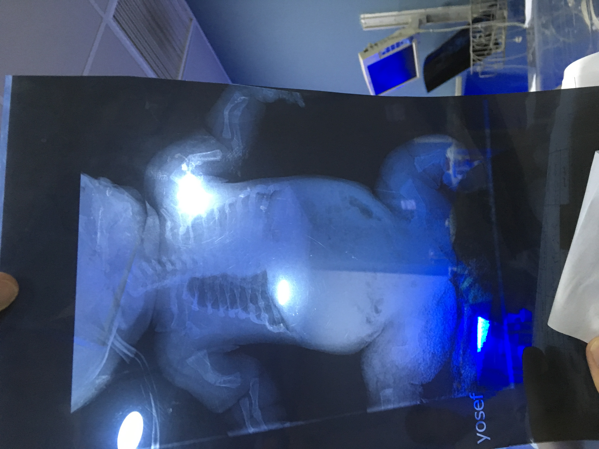
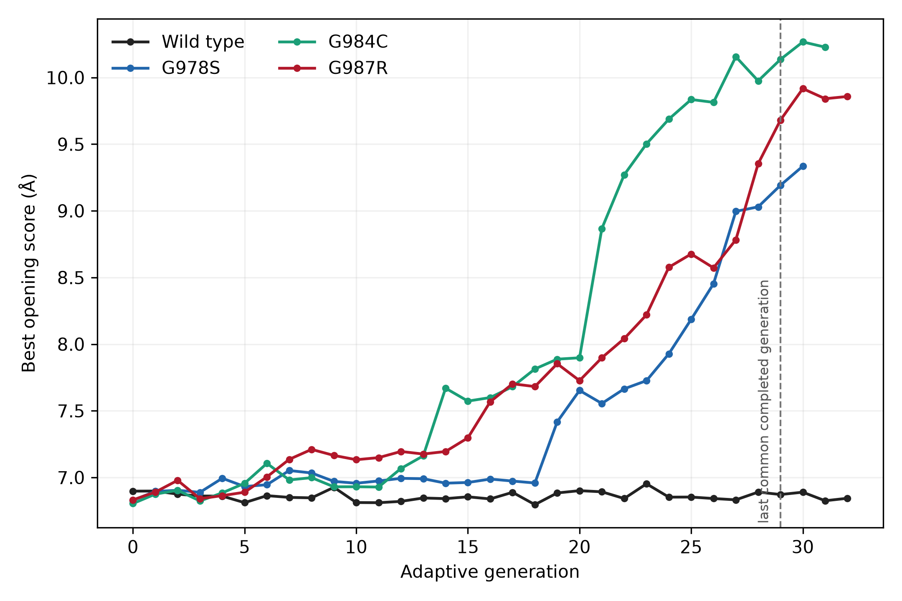

# Collagen remodelling in osteogenesis imperfecta

This repository is a computational research programme examining how
triple-helix-disrupting collagen substitutions alter collagen structure and its
interaction with matrix metalloproteinase-1 (MMP-1).

The work is motivated by **osteogenesis imperfecta (OI)**, a genetically and
clinically heterogeneous group of connective-tissue disorders characterised by
bone fragility. Many forms involve quantitative or qualitative abnormalities in
type I collagen. Radiographic findings vary with subtype and severity, but can
include reduced mineral density, recurrent fractures, healing callus, long-bone
bowing and progressive skeletal deformity.

<p align="center">
  
</p>

<p align="center"><sub>
Radiograph illustrating one severe presentation of OI. This image is not
representative of every OI subtype. Image: Ali zeki, CC BY 4.0; full attribution
is provided in <a href="docs/IMAGE_CREDITS.md">IMAGE_CREDITS.md</a>.
</sub></p>

## Research hypothesis

We hypothesise that glycine substitutions capable of destabilising local
triple-helical packing can change the structural accessibility of
collagenase-sensitive regions and thereby alter MMP-1-mediated collagen
remodelling.

This is a **mechanistic hypothesis**, not an established disease mechanism. The
present simulations do not demonstrate that altered MMP-1 activity causes the
clinical pathology of OI. Abnormal remodelling could contribute to disease,
have little causal relevance, or form part of a compensatory response. The
programme is designed to distinguish structural observations from those larger
causal claims.

## Two complementary simulation programmes

### 1. MMP-1-bound adaptive sampling

The first programme examines wild-type and substituted model collagen in the
presence of MMP-1. Adaptive sampling enriches locally opened conformations near
the collagenase-recognition region and asks how readily each model system can
access those structures.

- [Programme overview](projects/mmp1-bound-adaptive/README.md)
- [Detailed workflow reference](docs/ADAPTIVE_WORKFLOW_REFERENCE.md)
- [Structural-analysis methods](docs/STRUCTURAL_ANALYSIS.md)

<p align="center">
  
</p>

Adaptive sampling deliberately favours a chosen structural coordinate. It is
therefore useful for comparing accessible opening pathways, but it does not by
itself provide an unbiased equilibrium population or a spontaneous unwinding
rate.

### 2. MMP-1-free apo-collagen simulations

The second programme removes MMP-1 and uses conventional, unbiased molecular
dynamics. Three independent replicas of each substituted collagen system were
prepared with distinct velocities and continued into long-timescale production
simulations. This tests whether local opening is populated without enzyme
binding and without adaptive selection.

- [Programme overview](projects/apo-collagen/README.md)

A matched wild-type apo ensemble is required before any opening difference can
be attributed specifically to a substitution rather than to the baseline
dynamics of the model collagen peptide.

## Model scope and limitations

The simulated substrate is the synthetic homotrimeric model collagen peptide
used in the MMP-1 complex represented by PDB 4AUO. It is not full-length native
human type I collagen, which is normally a heterotrimer, and its residue numbers
are model-peptide coordinates rather than `COL1A1` or `COL1A2` HGVS positions.

The G978S, G984C and G987R substitutions are controlled model perturbations used
to examine the structural consequences of replacing glycine within a collagen
triple helix. They should not be described as direct simulations of particular
patient variants without an explicit sequence mapping and clinical annotation.

Additional limitations include finite peptide length, force-field and water-model
approximations, limited sampling, and the distinction between molecular opening,
matrix remodelling and organism-level disease.

## Publications

The current manuscript is a **working draft** and has not yet completed peer
review. It is provided to make the analysis and interpretation transparent.

- [Publication record and status](publications/README.md)
- [Read the manuscript in Markdown](manuscript/MMP1_collagen_OI_adaptive_unwinding_manuscript.md)
- [Download the manuscript PDF](manuscript/MMP1_collagen_OI_adaptive_unwinding_manuscript.pdf)

## Repository map

| Path | Purpose |
|---|---|
| `projects/mmp1-bound-adaptive/` | Scientific overview of the MMP-1-bound adaptive programme |
| `projects/apo-collagen/` | Scientific overview of the MMP-1-free conventional-MD programme |
| `scripts/` | OpenMM preparation, simulation and monitoring scripts |
| `analysis/` | Structural-analysis and figure-generation code |
| `generated_mutants/` | Prepared model systems and topology files |
| `docs/` | Detailed methods, workflow references and attribution |
| `manuscript/` | Working manuscript, figures and supporting material |
| `publications/` | Publication status and links |

Large production trajectories are not intended for Git storage. They should be
deposited in an appropriate research-data archive with checksums, metadata and a
persistent identifier when the study is released.

## Reproducibility

Create the documented OpenMM environment from the repository root:

```bash
conda env create -f environment.yml
conda activate openmm
```

The programme uses explicit periodic-boundary handling and retains complete
topology, preparation and analysis records. Study-specific commands are given in
the two programme overviews and in the detailed workflow documents.

## Project status

This is active research. Results and interpretations may change as the apo
ensembles, wild-type controls and longer trajectories are completed.
