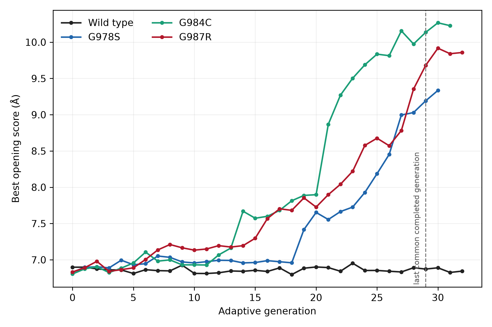
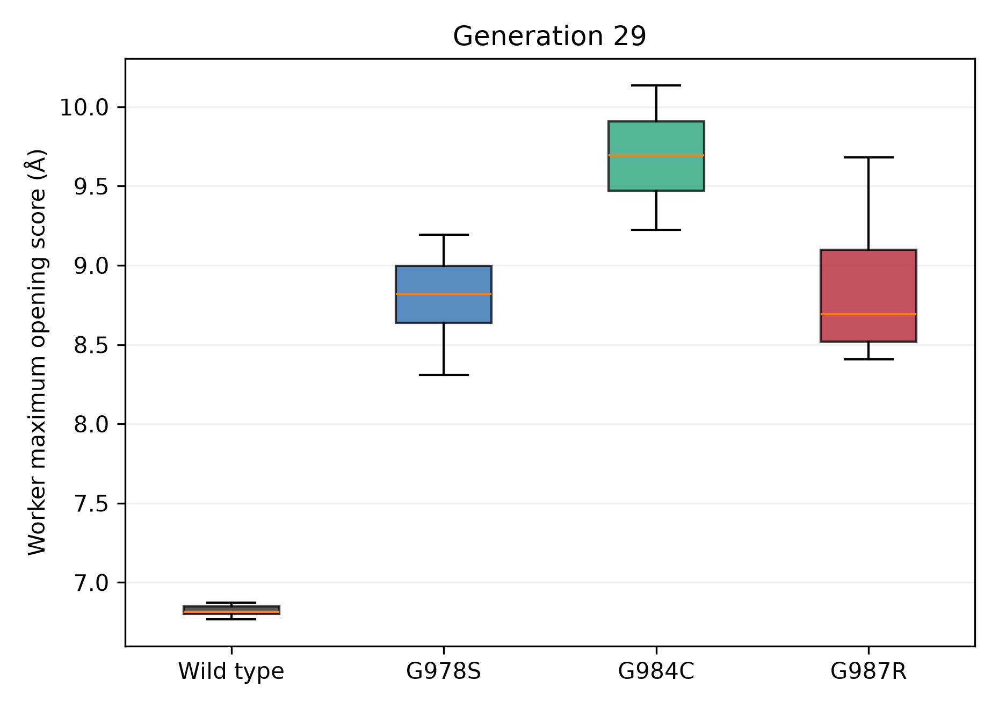

# Osteogenesis imperfecta glycine substitutions promote local collagen unwinding in an MMP-1 complex

*Adaptive atomistic molecular dynamics study*

## Abstract

Matrix metalloproteinase 1 (MMP-1) must locally open the collagen triple helix before a single chain can enter its narrow catalytic cleft. Glycine substitutions associated with osteogenesis imperfecta disturb triple-helical packing, but their effect on collagen opening at an MMP-1 binding site remains unclear. We used adaptive atomistic molecular dynamics to compare an MMP-1-bound wild-type collagen peptide with three single-chain substitutions positioned around the collagenase cleavage region: G978S, G984C and G987R. Each adaptive generation comprised ten independent 20 ns simulations. The frame with the largest periodic-boundary-corrected mean separation between corresponding Cα atoms in residues 977-987 seeded the next generation. A generation-matched analysis covered 30 generations and 6 microseconds of production simulation per system. The wild-type opening score remained stable, changing from 6.897 Å at generation 0 to 6.872 Å at generation 29. In contrast, G978S, G984C and G987R reached 9.192, 10.136 and 9.681 Å, corresponding to increases of 34.6%, 49.0% and 41.7%. G984C crossed 10 Å at generation 27, while the wild-type system never crossed 7 Å. Frame-level distributions and worker maxima showed that the separation was sustained across the sampled ensembles rather than arising from one isolated frame. These simulations indicate that glycine substitution can expose an opening pathway within the MMP-1-bound collagen cleavage region. The adaptive procedure identifies accessible routes and does not provide equilibrium populations or free energies; structural contact and hydrogen-bond analyses are therefore required before the changes can be assigned to a specific catalytic mechanism.

**Keywords:** collagen  osteogenesis imperfecta  matrix metalloproteinase 1  adaptive molecular dynamics  triple helix

## Introduction

Type I collagen obtains much of its mechanical stability from a tightly packed triple helix in which glycine occupies every third position. The absence of a side chain allows glycine to fit at the centre of the helix, where there is little space for any other residue. Substitution of even one glycine can disturb local packing and hydrogen bonding, delay folding, and alter the register of the three chains [1,2]. These structural defects account for many dominant forms of osteogenesis imperfecta, although the response depends on both the replacing residue and its sequence position.

The same local structure controls collagen turnover. Interstitial collagenases bind the intact triple helix but cannot place all three chains within the catalytic cleft. Biochemical experiments showed that MMP-1 first opens the substrate and then cleaves the constituent chains in succession [3]. The crystal structure of MMP-1 bound to a triple-helical collagen peptide clarified the extensive contacts made by the catalytic and hemopexin domains, while leaving the scissile bond outside a productive catalytic geometry [4]. Local movement of the collagen chain nearest the active site is therefore an essential part of the reaction rather than a passive consequence of hydrolysis.

Glycine substitutions close to the cleavage region could change this opening step in two opposing ways. A substitution may loosen the triple helix and increase access to an individual chain. It may also disrupt the MMP-1 binding geometry that directs the substrate towards the active site. Conventional molecular dynamics may not resolve either response within an accessible trajectory because spontaneous opening is rare and the helix can remain trapped near its starting structure.

We investigated this problem using parallel adaptive molecular dynamics. Ten independent simulations were run in each generation and the most open conformation was used to initiate the next set of workers. The study compared wild-type collagen with serine, cysteine and arginine substitutions at three glycine positions around the 4AUO collagenase cleavage region. We asked whether the substitutions changed the accessibility of an opening pathway, whether the response was sustained across workers and frames, and whether the position and identity of the mutation produced distinct unwinding profiles.

## Results and discussion

### The adaptive campaigns provide a balanced comparison through generation 29

The supplied dataset contained 129 generation records and 1,291 worker records from four independently propagated systems. G978S had completed generations 0-29, G984C generations 0-30, and wild type and G987R generations 0-31. The subsequent generation in each campaign was still running when the report was assembled. We therefore used generation 29 as the final common endpoint and excluded later generations from direct comparisons. This matched interval represents 300 completed 20 ns workers for each system, or 6 microseconds of production simulation per system and 24 microseconds in total. Approximately 2.40 million opening-score frames contributed to the common analysis.

All four systems began with similar opening scores. Generation 0 values ranged from 6.804 Å for G984C to 6.897 Å for wild type, a difference of less than 0.1 Å. The common starting range makes the later separation unlikely to reflect a simple offset introduced during preparation. The adaptive trajectories should nevertheless be read as four directed searches rather than as independent equilibrium ensembles.

### Glycine substitutions reveal opening pathways that are absent from wild type

The wild-type system remained within a narrow band throughout the campaign (Fig. 1). Its best score was 6.897 Å at generation 0 and 6.872 Å at generation 29. A linear description across the matched generations gave a slope of 0.0002 Å per generation, which is indistinguishable from directional progress at the precision relevant here. The wild-type system never reached 7 Å, despite the repeated selection of its most open frame. This behaviour provides an internal control for the adaptive procedure: selection alone did not force progressive opening when the starting collagen sequence was retained.

Each glycine substitution followed a different path. G978S first reached 7 Å at generation 7, passed 8 Å at generation 25 and passed 9 Å at generation 28. G987R reached 7 Å at generation 6, 8 Å at generation 22 and 9 Å at generation 28. G984C also passed 7 Å at generation 6 but then opened earlier, crossing 8 Å at generation 21, 9 Å at generation 22 and 10 Å at generation 27. At the matched endpoint, the best scores were 9.192 Å for G978S, 10.136 Å for G984C and 9.681 Å for G987R. These values correspond to increases of 2.363 Å, 3.332 Å and 2.849 Å from generation 0.

*Figure 1  Adaptive opening of wild-type and substituted collagen. The opening score is the mean of 33 periodic-boundary-corrected distances between corresponding Cα atoms across the three collagen chains for residues 977-987. Each point is the largest score selected from ten 20 ns workers. The dashed line marks generation 29, the last generation completed by all four systems. Later points are shown for context but were not used in matched endpoint comparisons.*

| System | Generation 0 Å | Generation 29 Å | Change Å | Change percent | First gen ≥ 9 Å |
| --- | --- | --- | --- | --- | --- |
| Wild type | 6.897 | 6.872 | -0.025 | -0.4 | Not reached |
| G978S | 6.829 | 9.192 | +2.363 | +34.6 | 28 |
| G984C | 6.804 | 10.136 | +3.332 | +49.0 | 22 |
| G987R | 6.832 | 9.681 | +2.849 | +41.7 | 28 |

*Table 1  Generation-matched changes in the adaptive collagen opening score.*

### Opening is sustained across frames and independent workers

The selected maximum from a generation is intentionally sensitive to rare conformations, so we examined the underlying worker and frame distributions. At generation 29, the median of the ten worker maxima was 6.814 Å for wild type, compared with 8.820 Å for G978S, 9.695 Å for G984C and 8.693 Å for G987R (Fig. 2). The interquartile ranges were 6.800-6.848 Å, 8.638-8.998 Å, 9.470-9.907 Å and 8.518-9.098 Å, respectively. The substituted systems therefore remained separated from wild type even when the single selected parent frame was ignored.

The same pattern was present across all recorded production frames. Generation 29 contained 20,000 frames per system. Mean opening scores were 6.539 ± 0.076 Å for wild type, 7.239 ± 0.525 Å for G978S, 7.801 ± 0.659 Å for G984C and 7.434 ± 0.414 Å for G987R, where the dispersion describes frames and should not be interpreted as uncertainty from independent biological replicates. Wild type remained tightly distributed, while each substitution broadened the accessible range and shifted its centre towards larger chain separation.

*Figure 2  Distribution of worker maxima at generation 29. Each box contains the maximum opening score from one of ten completed 20 ns workers. Boxes show the median and interquartile range; whiskers extend to the conventional 1.5 interquartile range limit.*

### The response depends on mutation position and residue identity

G984C produced the earliest large transition and the highest opening score. G978S opened more slowly, while G987R showed the widest worker-to-worker distribution at the common endpoint. The calculations do not isolate amino-acid identity from sequence position because each replacement was introduced at a different glycine. It would therefore be unsafe to conclude that cysteine is intrinsically more disruptive than arginine or serine from these data alone. The result instead shows that the three clinically motivated substitutions create distinct opening pathways within the same MMP-1-bound sequence.

The mutation was present on only one collagen chain, yet the score averaged all three pairwise chain separations. Progressive increases therefore require a change in the local three-chain geometry rather than movement of an isolated side chain. Residue-resolved separations, triangular opening area, hydrogen bonds and MMP-1 contacts are needed to determine whether the selected conformations represent asymmetric extrusion of one chain, collective expansion of the triple helix, or changes in the orientation of the whole substrate. Those analyses are particularly important for G984C, where a high mean score could arise from several geometries with different implications for catalytic access.

### Adaptive selection identifies accessibility rather than thermodynamic stability

The campaign was designed to find an opening route, not to estimate its equilibrium probability. Every generation inherited the most open conformation from the preceding generation, and all ten children shared that structural parent before receiving independently generated velocities. Generation values are consequently genealogically related, and the later workers are conditional on previous selection. Standard hypothesis tests that assume independent observations would overstate the evidence. For the same reason, the frequency of an opening score in this dataset cannot be converted into a free-energy difference.

Within that scope, the comparison is informative. The same selection rule, temperature, pressure, force field, simulation length and worker count were applied to all four systems. Wild type resisted directional change over 30 matched generations, whereas every substitution progressed to a state that was not reached by wild type. The result supports a difference in pathway accessibility. Demonstrating a difference in equilibrium stability or collagenolytic rate will require unbiased simulations initiated from representative closed and open states, free-energy calculations, or experimental cleavage measurements.

## Conclusions

Adaptive molecular dynamics exposed a marked sequence dependence in local collagen opening while bound to MMP-1. Wild-type collagen remained close to its starting separation after repeated selection, whereas G978S, G984C and G987R followed progressive opening pathways. G984C produced the largest and earliest response, reaching a best score above 10 Å by generation 27. The effect was also visible in the distributions of independent workers and production frames, indicating that it did not depend on one transient coordinate.

These findings connect two established features of collagen biology: glycine substitutions perturb the tightly packed triple helix, and collagenase requires local opening before hydrolysis. The present calculations show that substitutions around the cleavage region can alter access to that opening pathway in an MMP-1 complex. They do not yet establish the detailed contact rearrangement or the effect on catalytic rate. Residue-resolved structural analysis provides the next test of whether chain separation is accompanied by loss of interchain hydrogen bonds, altered MMP-1 contacts and movement of a single collagen chain towards the catalytic cleft.

## Methods

### MMP-1 collagen systems

The starting complex was based on the human MMP-1 triple-helical collagen peptide structure deposited as PDB 4AUO [4]. The collagen register follows the coordinate numbering of that structure, with the cleavage-region glycine assigned as residue 981. The MMP-1 model contained the catalytically competent Glu200 residue and the structural and catalytic zinc ions. Four collagen systems were prepared: wild type, G978S, G984C and G987R. Each substitution was introduced on collagen chain 1 only; the corresponding positions on chains 2 and 3 remained glycine.

Each complex was represented with the Amber99SB-ILDN protein force field [5] and TIP3P water [6]. Systems were neutralised and supplemented with 57 sodium-chloride pairs to a target concentration of 150 mM. The final wild-type, G978S and G984C systems contained 18,745 water molecules, 57 sodium ions and 67 chloride ions. G987R contained 18,744 water molecules, 57 sodium ions and 68 chloride ions because the arginine substitution changed the system charge.

### Molecular dynamics protocol

Simulations were performed with OpenMM 8 [7]. Long-range electrostatics were evaluated using particle mesh Ewald summation [8] with a 1.0 nm real-space cut-off. Bonds involving hydrogen were constrained and water molecules were rigid. A Langevin middle integrator maintained the temperature at 310.15 K with a friction coefficient of 1 ps-1 and a 2 fs time step. Pressure was maintained at 1 bar with a Monte Carlo barostat attempted every 25 integration steps. CUDA mixed precision was used for production simulations.

Generation 0 began with energy minimisation for up to 500 iterations, followed by 50 ps in the NVT ensemble and 200 ps in the NPT ensemble. Each worker then completed 20 ns of NPT production simulation. Frames and opening scores were recorded every 10 ps. Production checkpoints were written every 200 ps. Ten workers were required for a completed generation. Random seeds were derived deterministically from a master seed of 90210, the generation number, worker number and retry attempt.

### Adaptive selection

The opening region comprised residues 977-987 on each of the three collagen chains. At each recorded frame, minimum-image distances were calculated between corresponding Cα atoms for chain pairs 1-2, 1-3 and 2-3. The opening score was the mean of these 33 distances. This periodic-boundary correction prevented molecular imaging from being mistaken for collagen opening. The highest-scoring frame across the ten completed workers was retained as the parent for the next generation.

All ten workers in subsequent generations began from the selected parent coordinates. Parent-seeded generations skipped minimisation to preserve the selected geometry, then completed the same 50 ps NVT and 200 ps NPT equilibration stages. Velocities were generated stochastically and scaled, within predefined limits of 0.5-2.0, to match the kinetic energy of the parent when that energy was available. The procedure then repeated until the campaign stopped or reached its target generation.

### Unwinding data analysis

The joint report contained frame-level opening scores, worker summaries and generation summaries. Generation 29 was the last generation completed by every system and was selected before comparative analysis. We calculated changes from generation 0, the first generation at which each system crossed 7, 8, 9 and 10 Å, descriptive slopes across generations 0-29, distributions of worker maxima and frame-level means and standard deviations. The 985 MB frame table was processed in chunks and only completed or approximately completed workers were included in frame aggregates. No inferential p values were calculated because workers in later generations share an adaptively selected lineage.

## Data and code availability

Simulation preparation, adaptive sampling, monitoring and analysis code are available at https://github.com/acnash/mmp1-collagen-oi-adaptive-md. The repository includes the prepared wild-type and substituted systems, system-specific SLURM launchers and the scripts used to generate the joint unwinding report. Compact structural analysis can be generated directly on the simulation server without transferring trajectory files.

## References

1. Xiao J, Cheng H, Silva T, Baum J, Brodsky B. Osteogenesis imperfecta missense mutations in collagen: structural consequences of a glycine to alanine replacement at a highly charged site. Biochemistry. 2011;50:10771-10780. doi:10.1021/bi201476a.

2. Clements KA, Acevedo-Jake AM, Walker DR, Hartgerink JD. Glycine substitutions in collagen heterotrimers alter triple helical assembly. Biomacromolecules. 2017;18:617-624. doi:10.1021/acs.biomac.6b01808.

3. Chung L, Dinakarpandian D, Yoshida N, Lauer-Fields JL, Fields GB, Visse R, Nagase H. Collagenase unwinds triple-helical collagen prior to peptide bond hydrolysis. EMBO J. 2004;23:3020-3030. doi:10.1038/sj.emboj.7600318.

4. Manka SW, Carafoli F, Visse R, Bihan D, Raynal N, Farndale RW, Murphy G, Enghild JJ, Hohenester E, Nagase H. Structural insights into triple-helical collagen cleavage by matrix metalloproteinase 1. Proc Natl Acad Sci USA. 2012;109:12461-12466. doi:10.1073/pnas.1204991109.

5. Lindorff-Larsen K, Piana S, Palmo K, Maragakis P, Klepeis JL, Dror RO, Shaw DE. Improved side-chain torsion potentials for the Amber ff99SB protein force field. Proteins. 2010;78:1950-1958. doi:10.1002/prot.22711.

6. Jorgensen WL, Chandrasekhar J, Madura JD, Impey RW, Klein ML. Comparison of simple potential functions for simulating liquid water. J Chem Phys. 1983;79:926-935. doi:10.1063/1.445869.

7. Eastman P, Galvelis R, Peláez RP, et al. OpenMM 8: molecular dynamics simulation with machine learning potentials. J Phys Chem B. 2024;128:109-116. doi:10.1021/acs.jpcb.3c06662.

8. Darden T, York D, Pedersen L. Particle mesh Ewald: an N log N method for Ewald sums in large systems. J Chem Phys. 1993;98:10089-10092. doi:10.1063/1.464397.
