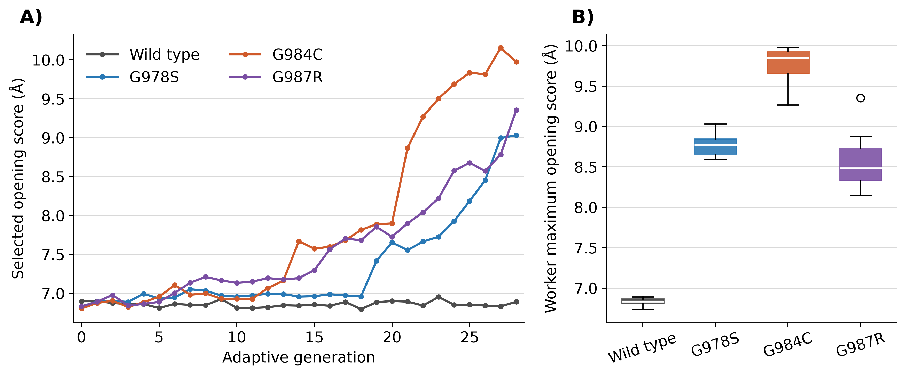
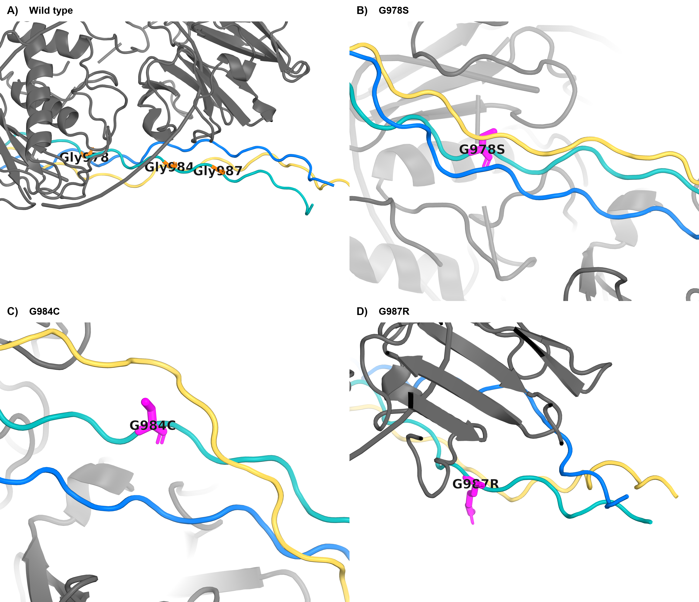
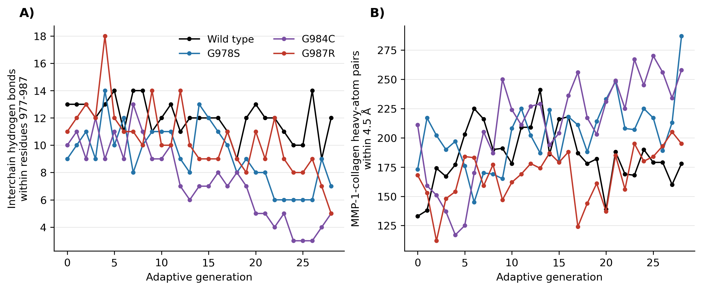
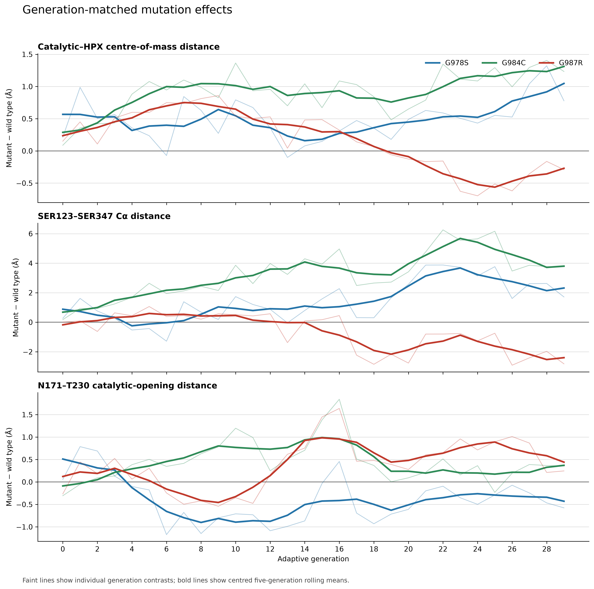

# Osteogenesis imperfecta-associated glycine substitutions encode local triple-helix packing vulnerability relevant to MMP-1-mediated matrix remodelling

*Adaptive atomistic molecular dynamics study*

**Anthony Nash¹, Chase Harms¹, Susanta K Sarkar¹**

¹ Arizona State University

**Corresponding author:** Anthony Nash (info@acnash.co.uk)

## Abstract

Osteogenesis imperfecta (OI)-associated collagen glycine substitutions compromise triple-helical organisation and stability. Their influence on enzymatic remodelling remains unclear. Matrix metalloproteinase 1 (MMP-1) must deform and locally separate collagen chains before cleavage. We therefore used adaptive molecular dynamics of the MMP-1-collagen complex to test whether substitutions alter triple-helix separation. The MMP-1-bound synthetic collagen homotrimer in PDB 4AUO was compared with glycine-to-serine, glycine-to-cysteine and glycine-to-arginine substitutions. Reported COL1A2 variants motivated the serine and arginine substitutions, and a COL1A1 variant motivated the cysteine substitution. During adaptive sampling, the wild-type selected local chain-separation score remained unchanged, shifting from 6.897 to 6.890 Å, whereas the serine-, cysteine- and arginine-substituted systems reached 9.030, 9.975 and 9.354 Å, respectively. Substituted systems showed loss of interchain hydrogen bonds, increased φ/ψ dispersion and reorganisation of collagen-MMP-1 contacts. The cysteine-substituted system produced consistent separation between the catalytic and hemopexin domains, whereas the serine- and arginine-substituted systems uncoupled domain separation from the N171-T230 catalytic-opening coordinate. Patient-derived type I collagen with the corresponding glycine-to-cysteine substitution in the MMP-1 binding region has shown faster MMP-1 cleavage than normal collagen. These findings identify sequence-encoded packing vulnerabilities that may alter abnormal-collagen engagement with MMP-1 during matrix remodelling.

**Keywords:** model collagen peptide  osteogenesis imperfecta-associated mutation  abnormal matrix remodelling  collagen packing vulnerability  matrix metalloproteinase 1  adaptive molecular dynamics

## Introduction

Type I collagen is stabilised by a tightly packed triple helix in which glycine occupies every third position. Glycine's single-hydrogen side chain permits close packing at the helical centre, whereas replacement with serine, cysteine or arginine introduces a larger side chain into this sterically constrained environment. The resulting changes in packing, hydrogen bonding and chain register contribute to collagen packing vulnerability in many dominant forms of osteogenesis imperfecta. Importantly, this vulnerability is heterogeneous: its structural expression depends on both the replacing residue and its position within the collagen sequence [1,2].

The same local packing that supports tissue-bearing collagen must also be deformed during normal matrix turnover. MMP-1 binds the triple helix, separates the chains locally and then cleaves them in succession [3]. An OI-associated substitution could therefore alter both the structure of collagen in isolation and the mechanical response of the triple helix while it is engaged by a remodelling enzyme. In the 4AUO crystal structure, the catalytic and hemopexin domains of catalytically inactive MMP-1(E200A) contact a synthetic model collagen homotrimer while the scissile bond remains outside productive catalytic geometry [4]. This experimentally resolved complex provides a structurally grounded system in which to compare mutation-dependent responses without assigning the model peptide to a particular native collagen type or patient substrate. Separation and communication between the catalytic and hemopexin domains have been associated with collagen-bound MMP-1 activity and proposed to facilitate access to the catalytic pocket [5]. We therefore also tested whether substitution-induced collagen separation altered the distance between these domains.

Structurally altered collagen can also undergo abnormal extracellular matrix handling. Patient-derived fibroblast matrices can deposit less type I collagen, selectively retain normal over abnormal trimers and lose incorporated mutant collagen more rapidly [6,7]. Separately, type I collagen substitutions close to the canonical collagenase-recognition region have increased cleavage by MMP-1 in vitro, with the greater susceptibility attributed to local triple-helix destabilisation [8]. A recombinant construct containing the human COL1A2 collagenase-recognition sequence has also shown that G772S disrupts interchain hydrogen bonding while retaining similar or slightly increased MMP-1 susceptibility [9]. These observations support a testable model in which disease-associated glycine substitutions loosen local collagen packing and increase access for MMP-1. We therefore asked whether three clinically motivated substitutions produced different patterns of chain separation while bound to MMP-1.

Each substitution is present in the starting model, so adaptive sampling begins with the altered side chain already embedded in the collagen triple helix. A substituted peptide can begin in a closed structure and then differ from wild type in how readily its chains move apart. Near the collagenase-recognition region, this local loosening may change both collagen flexibility and its contacts with MMP-1.

To compare mutation-dependent local chain separation, we used successive rounds of adaptive sampling. In each round, termed an adaptive generation, ten independent simulations, termed workers, began from the same parent structure with independently generated velocities. The structure showing the greatest local chain separation was then used to begin the next generation. Reported COL1A2 p.Gly772Ser and p.Gly781Arg variants motivated the serine and arginine substitutions [10,11], while patient-derived COL1A1 p.Gly773Cys motivated the cysteine substitution [12]. In the prepared 4AUO model, these substitutions are designated G978S, G987R and G984C, respectively. These numbers follow the model-peptide coordinate register rather than the residue numbering of native human COL1A1 or COL1A2. We asked whether the three substitutions produced distinguishable local packing vulnerabilities, altered the collective behaviour of the collagen chains and generated effects that persisted across independent workers and sampled frames.

## Results and discussion

### Adaptive sampling reveals progressive mutation-dependent collagen packing separation

Repeated adaptive selection produced a clear sequence-dependent divergence in local collagen packing. Wild type remained close to its starting separation throughout the analysed interval, whereas all three clinically motivated substituted systems progressively accessed more separated states. The comparison comprised 290 completed 20 ns workers per system, corresponding to 5.8 microseconds of aggregate production simulation per lineage and 23.2 microseconds overall. Approximately 2.32 million separation-score frames contributed to the analysis. This sampling interval was sufficient to resolve the response across selected structures, parallel workers and uniformly sampled trajectory frames.

Generation-0 values for the mean local interchain Cα separation score across residues 977-987 ranged by only 0.093 Å: 6.897 Å for wild type, 6.829 Å for G978S, 6.804 Å for G984C and 6.832 Å for G987R. This narrow range establishes closely matched starting values for the local packing measure used to guide adaptive selection. The replacement residues and their altered packing potentials were already present within those closed structures. The three substituted systems subsequently increased by 2.201-3.170 Å, showing how readily each starting structure accessed greater local chain separation under the same adaptive protocol. These lineages are directed conformational searches rather than independent equilibrium ensembles.

Wild type remained within a narrow band throughout the common analysis window (Fig. 1A), changing from 6.897 Å at the initial generation to 6.890 Å in the final generation included in the comparison and never reaching 7 Å. Repeated selection alone therefore did not force progressive chain separation in a sequence that retained glycine at all three tested positions.

Against this stable reference, each glycine substitution expressed its packing vulnerability along a different path. G978S first reached 7 Å at generation 7, passed 8 Å at generation 25 and passed 9 Å at generation 28. G987R reached 7 Å at generation 6, 8 Å at generation 22 and 9 Å at generation 28. G984C passed 7 Å at generation 6 and then accelerated earlier, crossing 8 Å at generation 21, 9 Å at generation 22 and 10 Å at generation 27. The last selected scores included in the common comparison were 9.030 Å for G978S, 9.975 Å for G984C and 9.354 Å for G987R, corresponding to increases of 2.201, 3.170 and 2.522 Å across the analysed interval (Table 1). The matched protocol revealed sequence-encoded differences in the accessibility of separated local packing states. Wild type remained stable under the same selection pressure, confirming that adaptive propagation alone was insufficient to produce the response.

*Figure 1  Adaptive local packing separation and worker-level variability. (A) The selection score is the mean of 33 periodic-boundary-corrected distances between corresponding Cα atoms across the three collagen chains for residues 977-987. Each point is the largest score selected from ten 20 ns workers. (B) Distribution of the maximum selection score from each of the ten workers at the final shared sampling point, generation 28. Boxes show the median and interquartile range; whiskers extend to the conventional 1.5 interquartile range limit.*

| System | Generation 0 Å | Generation 28 Å | Change Å | Change percent | First gen ≥ 9 Å |
| --- | --- | --- | --- | --- | --- |
| Wild type | 6.897 | 6.890 | -0.007 | -0.1 | Not reached |
| G978S | 6.829 | 9.030 | +2.201 | +32.2 | 28 |
| G984C | 6.804 | 9.975 | +3.170 | +46.6 | 22 |
| G987R | 6.832 | 9.354 | +2.522 | +36.9 | 28 |

*Table 1  Changes in the adaptive collagen separation score across the common analysis window, from generation 0 to generation 28.*

### Increased local separation is sustained across frames and parallel workers

The adaptive procedure selected the single frame with the greatest local chain separation from each generation. We therefore tested whether greater separation was also present across many sampled frames and parallel workers at the final shared sampling point. The median worker maximum was 6.833 Å for wild type, 8.773 Å for G978S, 9.851 Å for G984C and 8.485 Å for G987R (Fig. 1B), with respective interquartile ranges of 6.807-6.865, 8.657-8.847, 9.654-9.926 and 8.330-8.724 Å. Across 1,000 uniformly sampled frames per system, mean scores were 6.552 ± 0.076, 7.303 ± 0.467, 7.700 ± 0.625 and 7.460 ± 0.402 Å. The dispersion describes temporal variation among frames. Both analyses distinguish the substituted systems from wild type and show that greater separation was present across sampled frames and parallel workers.

### Each substitution produces a distinct pattern of local collagen separation

The three substitutions differed in when chain separation began, how far it progressed and how much it varied among workers. Among the substituted systems, G984C showed the earliest large increase and the highest score, G978S progressed more slowly than G984C and G987R, and G987R showed the widest worker-to-worker distribution at the final shared sampling point.

Each substitution was present on one chain, whereas the selection score averaged all three pairwise chain separations. The same mean score could arise if one chain moved away from the other two or if all three chains moved apart. We therefore measured each chain pair separately and counted hydrogen bonds and MMP-1 contacts in the selected structures. At the final shared sampling point, the chain 1-chain 2, chain 1-chain 3 and chain 2-chain 3 distances differed among the substituted systems, while each collagen peptide remained bound to MMP-1 (Fig. 2).

*Figure 2  MMP-1-bound collagen structures selected at the final shared sampling point, generation 28. (A) Wild type, with Gly978, Gly984 and Gly987 highlighted; (B) G978S; (C) G984C; and (D) G987R. Structures were reconstructed across periodic boundaries and presented in a common orientation, with the hemopexin domain to the left, the catalytic domain to the right and MMP-1 above the collagen. MMP-1 is shown as a translucent grey cartoon and the three collagen chains as translucent purple cartoons. Highlighted residues are shown as outlined ball-and-stick models, with carbon in cyan, nitrogen in blue, oxygen in red, hydrogen in white and sulfur in yellow.*

Chain-pair analysis showed that the largest change between the selected generation 0 and 28 structures occurred between the two unmodified chains in every substituted system (Table 2). Their mean separation increased by 3.80 Å in G978S, 6.54 Å in G984C and 4.15 Å in G987R, compared with less than 0.01 Å in wild type. G978S illustrates the asymmetry particularly clearly: chain 1-chain 2 remained effectively closed while both distances involving chain 3 increased. Thus, the increase in mean separation involved movement among all three chains rather than movement of the substituted chain alone.

| System | Chain 1-chain 2 change Å | Chain 1-chain 3 change Å | Chain 2-chain 3 change Å |
| --- | --- | --- | --- |
| Wild type | +0.08 | -0.11 | +0.00 |
| G978S | -0.09 | +2.89 | +3.80 |
| G984C | +1.03 | +1.94 | +6.54 |
| G987R | +2.21 | +1.21 | +4.15 |

*Table 2  Change in the selected-structure mean Cα separation for each chain pair across the common analysis window, from generation 0 to generation 28, averaged across residues 977-987.*

### The three substitutions increase separation at different collagen residues

Because the three chain-pair distances changed by different amounts, we next measured the triangular area enclosed by the three corresponding Cα atoms to quantify how the cross-section of all three chains changed together. Across the common analysis window, the mean area in the selected structures changed from 17.23 to 17.58 Ų in wild type. The equivalent changes were from 17.53 to 27.40 Ų for G978S, 16.81 to 33.13 Ų for G984C and 17.17 to 37.20 Ų for G987R. The local Cα radius of gyration increased by 0.14 Å in wild type, compared with 0.72, 1.18 and 0.65 Å for G978S, G984C and G987R, respectively. After least-squares alignment of the Cα atoms at residues 977-987 on all three collagen chains, 33 atoms in total, to the corresponding atoms in the generation 0 structure, the local Cα root-mean-square displacement at the final shared sampling point was 0.82 Å for wild type and 2.67-3.67 Å for the substituted systems. Together, these measurements show that the increased mean interchain Cα separation across residues 977-987 reflects local movement of all three collagen chains.

The local increase in chain separation occurred at different residues in each substituted system (Fig. 3A). G978S produced its largest increase at residue 984, where the mean separation increased by 4.60 Å, and affected the central part of residues 977-987 more strongly than either end of this range. G984C produced its largest increase on the amino-terminal side of the substitution, with changes of 4.23-6.19 Å across residues 977-981 and a maximum at Gly981. G987R increased progressively towards the carboxy terminus, culminating in a 7.02 Å increase at the substituted residue. Thus, each clinically motivated substitution separated a different part of the collagen segment.

*Figure 3  Residue-resolved structural changes from generation 0 to generation 28. (A) Change in the mean of the three pairwise Cα separations at each collagen position. (B) Change in the number of collagen-MMP-1 heavy-atom contact pairs, summed across the three collagen chains. The dashed marker identifies the Gly975-Leu976 cleavage bond; coloured dotted markers identify the substituted residue in G978S, G984C and G987R. Wild type has no substitution. Positive values indicate an increase over the analysed interval.*

### Local collagen separation redistributes contacts with MMP-1

The corresponding residue-resolved contact analysis showed that G978S gained MMP-1 contacts mainly across residues 980-987, G984C gained them at residues 977-980 while losing them at 982-985, and G987R gained them across residues 982-987 (Fig. 3B). Because larger residues can contribute more heavy-atom pairs, this metric identifies where contact increased or decreased along the collagen sequence. All three substituted peptides therefore remained attached to MMP-1 while contacting different parts of its surface.

### Greater chain separation is accompanied by hydrogen-bond loss and wider φ/ψ angle distributions

Having established mutation-dependent increases in chain separation, we next asked whether interchain hydrogen bonds decreased over the same interval (Fig. 4A). Wild-type collagen retained 12 of the 13 interchain hydrogen bonds initially present within residues 977-987 in the selected structure from the final shared sampling point. G978S decreased from 9 to 7 bonds, G984C from 10 to 5 and G987R from 11 to 5. To reduce sensitivity to fluctuations in a single selected structure, we also compared five-generation windows at the beginning and end of the common analysis interval, generations 0-4 and 24-28. The wild-type mean changed from 12.8 to 11.0 bonds, whereas the corresponding values decreased from 10.6 to 6.8 for G978S, 10.2 to 3.6 for G984C and 13.2 to 7.4 for G987R. Across the selected structures, the correlation between the separation score and local interchain hydrogen-bond count was -0.61 for G978S, -0.86 for G984C and -0.71 for G987R, compared with 0.04 for wild type, showing that greater separation was associated with fewer local hydrogen bonds along each substituted adaptive lineage.

Chain-resolved counts showed that hydrogen-bond loss extended beyond the substituted chain. Bonds between chains 2 and 3 changed from an early-generation mean of 4.8 to 4.2 in wild type and decreased from 4.2 to 0.4 in G978S, from 4.2 to 0.0 in G984C and from 4.8 to 0.8 in G987R. Each substitution was introduced on chain 1, and the largest consistent loss occurred between the two unmodified chains. Separation of the triple helix therefore included hydrogen-bond loss between those two unmodified chains.

Hydrogen-bond loss was accompanied by a wider range of backbone angles over the same interval. Between generations 0-4 and 24-28, the circular standard deviation of φ/ψ angles within residues 977-987 changed by only 1.0°/0.5° in wild type. It increased by 4.2°/8.0° for G978S, 15.2°/12.2° for G984C and 14.7°/15.9° for G987R. Changes in ω dispersion were smaller than the φ/ψ changes, ranging from -0.3° to 1.2° in the substituted systems. The substituted systems therefore sampled a wider range of local φ/ψ angles as interchain hydrogen bonds were lost, while the peptide-bond ω angle changed little.

### Collagen remains associated with MMP-1 as local separation increases

Collagen remained closely associated with MMP-1 as its three chains moved apart locally. Heavy-atom contact counts increased between generations 0-4 and 24-28 (Fig. 4B), from 195.8 to 226.2 for G978S, 155.0 to 252.6 for G984C, 147.0 to 191.4 for G987R and 157.8 to 177.2 for wild type. The minimum collagen-MMP-1 distance remained close to 2.7 Å, showing that collagen retained close contact with MMP-1 while the locations of those contacts changed.

*Figure 4  Structural changes in the selected frame from each adaptive generation. (A) Interchain hydrogen bonds in which both residues lie within collagen positions 977-987. (B) Number of MMP-1-collagen heavy-atom pairs within 4.5 Å. The same selected structure was used for both measurements.*

### Trajectory-wide analysis confirms greater separation across production frames

The structure selected from each adaptive generation records the frame with the greatest separation. We next tested whether the underlying production trajectories showed the same increase by analysing every worker at generations 0, 10, 20 and 28, using 100 uniformly spaced production frames per worker. The resulting dataset comprised 16,000 frames from 160 workers, with complete coverage and no missing metric values. The worker-mean separation score remained nearly unchanged in wild type: the median across ten workers was 6.534 Å at the initial sampling point and 6.549 Å at the final sampling point (Fig. 5A). The corresponding medians increased from 6.512 to 7.309 Å for G978S, from 6.502 to 7.611 Å for G984C and from 6.488 to 7.482 Å for G987R. At the final sampling point, the interquartile ranges were 6.544-6.559 Å for wild type, 7.206-7.429 Å for G978S, 7.503-7.929 Å for G984C and 7.276-7.534 Å for G987R. The production frames of all parallel workers therefore reproduced the greater separation measured in the selected structures.

The loss of interchain hydrogen bonds was also present across the production frames: using a 3.5 Å donor-acceptor cut-off and a 135° minimum donor-hydrogen-acceptor angle, median worker means changed from 11.60 to 11.33 bonds in wild type, from 11.42 to 8.12 in G978S, from 11.02 to 6.50 in G984C and from 12.50 to 8.78 in G987R (Fig. 5B). The same ordering was obtained with a stricter 3.2 Å distance criterion and with minimum angles of 120° and 150°. Backbone-only counts decreased by 2.73-3.63 bonds in the substituted systems, compared with an increase of 0.14 bonds in wild type. This consistency across geometric definitions and atom selections supports a robust loss of interchain hydrogen bonding in the substituted systems.

Backbone dihedral angles provided a third measure of the same structural change. From generation 0 to 28, median worker-averaged φ circular standard deviations changed from 10.52° to 10.37° in wild type, compared with increases from 10.32° to 14.59° in G978S, from 10.71° to 13.25° in G984C and from 10.66° to 13.40° in G987R (Fig. 5C). The corresponding ψ values changed from 9.95° to 9.90° in wild type and increased to 14.93°, 12.79° and 11.44° in G978S, G984C and G987R. The increases occurred on multiple chains, showing that backbone flexibility increased across the triple helix rather than only on the substituted chain.

The increased collagen separation was accompanied by changes in collagen contacts with the MMP-1 catalytic domain: at the final sampling point, median residue-contact counts were 9.67 in wild type, 15.52 in G978S, 23.98 in G984C and 11.42 in G987R (Fig. 5D), while hemopexin-domain medians were 21.28-25.15. G984C showed the largest increase in catalytic-domain contacts, and all four collagen peptides remained attached to MMP-1.

Zinc coordination is represented by bonded interactions in this model, so the catalytic zinc served solely as a reference point for substrate placement. At the final sampling point, the median worker-mean distance from the nearest Gly975 scissile carbon to this reference was 9.24 Å in wild type and 10.30-12.20 Å in the substituted systems; every sampled value exceeded 7.64 Å. Thus, collagen chain separation and changing MMP-1 contacts occurred while the scissile region remained too far from the catalytic zinc to represent a cleavage-ready arrangement.

*Figure 5  Analysis of all ten workers at generations 0, 10, 20 and 28. Each worker contributes 100 production frames sampled at 200 ps intervals; boxes summarise worker means. (A) Local separation score, with faint matching-colour lines showing the selected opening score at each generation. (B) Interchain hydrogen bonds within residues 977-987 using a 3.5 Å donor-acceptor cut-off and 135° minimum donor-hydrogen-acceptor angle. (C) Mean φ circular standard deviation across the analysed residues and chains. (D) Unique collagen-MMP-1 residue contacts assigned to the catalytic domain. Boxes show the median and interquartile range; whiskers extend to the conventional 1.5 interquartile range limit.*

| System | Separation change Å | H-bond change | φ SD change ° | ψ SD change ° | Catalytic-contact change |
| --- | --- | --- | --- | --- | --- |
| Wild type | +0.015 | -0.28 | -0.16 | -0.04 | -3.00 |
| G978S | +0.797 | -3.30 | +4.27 | +5.39 | +1.49 |
| G984C | +1.109 | -4.52 | +2.55 | +2.63 | +12.61 |
| G987R | +0.995 | -3.72 | +2.74 | +1.46 | -0.69 |

*Table 3  Difference between the final and initial sampling-point medians of the ten worker means, corresponding to generations 28 and 0. Hydrogen bonds use the 3.5 Å/135° criterion. Dihedral values are mean residue- and chain-specific circular standard deviations.*

### Each collagen substitution changes MMP-1 domain distances differently

Because separation between the catalytic and hemopexin domains has been associated with active collagen-bound MMP-1 [5], we asked whether the changing collagen-MMP-1 contacts were accompanied by changes in this interdomain geometry. We therefore analysed three distances over generations 0-29: the mass-weighted distance between the catalytic and hemopexin domain centres, the SER123-SER347 Cα distance spanning the two domains, and the local N171-T230 Cα distance. The analysis comprised 119,911 uniformly sampled frames from 1,200 workers. Each mutant was compared with wild type at the same generation because successive generations inherit the structure selected in the preceding round.

Among the three substituted systems, G984C produced the largest increase in both interdomain distances (Fig. 6; Table 4). Relative to wild type, the catalytic-hemopexin centre-of-mass distance increased by a generation-averaged 0.91 Å and the SER123-SER347 distance by 3.26 Å. Both distances were larger than wild type in every generation. The SER123-SER347 difference from wild type also grew during adaptive propagation, rising from a mean of 1.00 Å over generations 0-4 to 4.21 Å over generations 25-29. The N171-T230 distance was a mean of 0.44 Å larger than wild type and followed a different generation-by-generation pattern.

G978S and G987R changed the three MMP-1 distances in different directions. Relative to wild type, G978S increased the centre-of-mass and SER123-SER347 distances by 0.49 and 1.44 Å, respectively, while decreasing the N171-T230 distance by 0.40 Å. Thus, its catalytic and hemopexin domains moved farther apart even as the local N171-T230 distance narrowed. G987R showed the converse pattern: its mean centre-of-mass distance differed little from wild type, its SER123-SER347 distance was 0.68 Å shorter than wild type, and its N171-T230 distance was 0.37 Å larger than wild type. Over generations 25-29, the G987R centre-of-mass and SER123-SER347 distances were 0.39 and 2.17 Å shorter than wild type, whereas N171-T230 was 0.65 Å larger than wild type. Across generations, the G987R centre-of-mass and N171-T230 differences from wild type were inversely related (Spearman ρ = -0.65).

The two interdomain distances tended to increase together across generations, whereas their relationship with N171-T230 was weak for G978S and G984C and negative for G987R. The N171-T230 distance therefore reports a local backbone movement that can increase or decrease independently of the distance between the catalytic and hemopexin domains. Specifically, G984C increased all three distances, G978S increased both interdomain distances while narrowing N171-T230, and G987R increased N171-T230 while shortening SER123-SER347. Direct measurements of catalysis are required to determine whether these distinct movements alter collagen cleavage.

*Figure 6  Generation-matched changes in three MMP-1 distances associated with the collagen substitutions: the mass-weighted catalytic-hemopexin centre-of-mass distance, the SER123-SER347 Cα distance and the local N171-T230 Cα distance. Faint lines show the mutant-minus-wild-type difference for each generation; bold lines show centred five-generation rolling means. The heavy horizontal line marks wild type: positive values indicate a larger distance and negative values a shorter distance. Because each generation inherits the structure selected in the preceding round, the lines show the distances reached during adaptive selection.*

| System | Catalytic-HPX centre-of-mass Δ Å | SER123-SER347 Δ Å | N171-T230 Δ Å |
| --- | --- | --- | --- |
| G978S | +0.49 (0.35 to 0.65) | +1.44 (0.62 to 2.37) | -0.40 (-0.66 to -0.12) |
| G984C | +0.91 (0.76 to 1.06) | +3.26 (2.31 to 4.24) | +0.44 (0.21 to 0.68) |
| G987R | +0.16 (-0.18 to 0.48) | -0.68 (-1.44 to 0.06) | +0.37 (0.02 to 0.69) |

*Table 4  Mean generation-matched mutant-minus-wild-type distance contrasts across generations 0-29. Values in parentheses are descriptive 95% circular moving-block bootstrap intervals for the mean contrast, using a block length of five generations. The intervals preserve short-range progression within each adaptive lineage and describe consistency within genealogically related sequences.*

### Adaptive selection distinguishes the collagen structures reached by each substitution

Each generation began from the structure with the greatest separation in the preceding round, so the campaign was designed to identify collagen structures reached under repeated selection. Under the same protocol, wild type remained close to its starting separation while every substituted sequence reached chain-separated structures absent from wild type, despite generation-0 scores spanning only 0.093 Å. Because the substitutions were present before adaptive propagation began, the different increases in chain separation arose from the collagen sequences rather than from the selection procedure. Equilibrium populations and collagen cleavage rates require unbiased simulations and direct kinetic measurements, respectively.

### Implications for abnormal MMP-1-mediated matrix remodelling

These results describe how disease-associated collagen substitutions change local collagen packing while bound to MMP-1. Structurally abnormal collagen has been shown to undergo inefficient matrix deposition and preferential extracellular loss [6,7]. In the adaptive trajectories, all three substituted peptides reached chain-separated structures through different generation-by-generation patterns. G984C separated earliest and by the largest amount among the three substitutions, G987R reached a greater final selected separation than G978S, and G978S increased more slowly than G984C and G987R. MMP-1 also changed differently with each collagen: G984C produced the largest increases in both interdomain distances, G978S produced smaller increases than G984C, and the G987R catalytic-hemopexin distance fell below wild type late in the adaptive series. Thus, increased collagen separation accompanied increased MMP-1 interdomain distance in the cysteine and serine systems, with each measurement describing a different physical change.

Experimental cleavage data support a connection between the structural changes observed here and MMP-1 susceptibility. In full-length type I collagen isolated from patient fibroblasts, alpha1(I)-G763S, alpha1(I)-G766C, alpha1(I)-R780L and alpha1(I)-R780C molecules were all cleaved by MMP-1 significantly faster than normal control collagen, with the increase more pronounced for G766C and the R780 substitutions than for G763S [8]. Disulphide-linked fractions of the cysteine-containing collagens were especially susceptible. The patient-derived G766C substitution lies in the same MMP-1-binding region and introduces the same residue type as model G984C. Our simulation places that cysteine in a synthetic homotrimer, on one chain and as a neutral protonated thiol without a disulphide bond, providing a simplified structural model of the experimental system. In a complementary recombinant bacterial-collagen system containing the human alpha2(I) recognition sequence, G772S caused extensive loss of interchain hydrogen bonding and similar or slightly increased MMP-1 digestion relative to the unmodified construct [9]. Together, these experiments link glycine substitution, loss of collagen hydrogen bonds and increased susceptibility to MMP-1 cleavage, while showing that the size of the kinetic increase varies between substitutions.

Interdomain separation has independently been associated with active MMP-1 on type I collagen fibrils, and communication between the catalytic and hemopexin domains has been proposed to facilitate access to the catalytic pocket [5]. Read together, the experiments and simulations support the following sequence: a glycine substitution allows the collagen chains to move farther apart locally; the altered collagen contacts MMP-1 differently and changes the distance between its catalytic and hemopexin domains; productive placement of the scissile bond may then increase cleavage. The present trajectories show the first step in all three substituted systems and the second most clearly in G984C and G978S, while direct cleavage measurements are needed to determine whether these structural changes increase catalytic processing.

The adaptive design tests how readily each collagen sequence reaches greater local separation under repeated selection. Unbiased relaxation simulations can now test how quickly those separated structures repack, and cleavage measurements on matched full-length heterotrimeric substrates can test how chain separation changes processing rates. The present study provides a structural explanation for why specific OI-associated substitutions may increase MMP-1 susceptibility.

## Conclusions

Adaptive molecular dynamics showed that OI-associated glycine substitutions allow MMP-1-bound model collagen chains to move farther apart locally, despite all four systems beginning from similar separation scores. Among the substituted systems, G984C separated earliest and by the largest amount, G987R showed the widest variation among workers, and G978S increased more slowly than G984C and G987R. Across production frames and workers, the substituted systems lost interchain hydrogen bonds, sampled wider φ/ψ angle ranges and changed which collagen residues contacted MMP-1. MMP-1 also moved differently with each collagen: G984C produced the largest increase in catalytic-hemopexin separation, G978S produced a smaller increase than G984C together with N171-T230 narrowing, and G987R increased N171-T230 while its catalytic-hemopexin distance later fell below wild type. These simulations connect specific disease-associated collagen substitutions to measurable changes in collagen packing and MMP-1 domain distances. The findings provide a structural explanation for experimental reports of selective mutant-collagen loss from matrix and faster MMP-1 cleavage of locally destabilised type I collagen [5-9].

## Methods

### MMP-1 collagen systems

The starting complex was based on PDB 4AUO, which contains human MMP-1 bound to a 40-residue synthetic homotrimeric model collagen peptide [4]. The peptide contains a collagenase-recognition region and terminal Gly-Pro-Hyp repeats that stabilize its triple-helical structure. It serves here as a general model collagen substrate independent of a specific native collagen type. The collagen register follows the numbering assigned in the prepared topology. The scissile Gly-Leu bond is Gly975-Leu976, and the analysed window at residues 977-987 corresponds to the P2′-P12′ region. The G978S, G984C and G987R models therefore place substitutions at P3′, P9′ and P12′, respectively; these numbers are model-peptide coordinates rather than COL1A1 or COL1A2 HGVS positions. The deposited crystallographic enzyme contains the inactive E200A substitution. The prepared simulation topology instead contains a deprotonated GLU residue at position 200 and explicit structural and catalytic zinc ions. Zinc coordination is represented by bonded interactions to the coordinating residues. The exact A200E rebuilding method and initial Glu200 rotamer are unavailable because the repository lacks the original coordinate-reconstruction record.

Four model collagen systems were prepared: the unmodified 4AUO peptide sequence and G978S, G984C and G987R substitutions. Each substitution was introduced on collagen chain 1 only; the corresponding positions on chains 2 and 3 remained glycine. The serine and arginine substitutions were selected from reported human disease evidence: COL1A2 c.2314G>A, p.Gly772Ser is classified as pathogenic or likely pathogenic and has been reported in patients with osteogenesis imperfecta [10], while COL1A2 c.2341G>C, p.Gly781Arg has likewise been identified as a pathogenic variant in affected patients [11]. These observations provided the patient-variant references for the serine and arginine choices. The substitutions were placed within the collagenase-recognition region of the 4AUO model peptide, whose coordinate register and homotrimeric sequence differ from native type I collagen; G978S and G987R are therefore clinically motivated model placements rather than direct HGVS equivalents of p.Gly772Ser and p.Gly781Arg.

The G984C model places a glycine-to-cysteine substitution at the corresponding position within the MMP-1 binding region of the synthetic 4AUO peptide. Its clinical motivation is supported by the reported de novo COL1A1 c.2317G>T, p.Gly773Cys variant in a patient with severe osteogenesis imperfecta [12]. Because 4AUO has a synthetic homotrimeric sequence and its own coordinate register, G984C is a model-peptide label rather than a native COL1A1 HGVS position. The calculations should consequently be interpreted as simulations of three clinically motivated substitutions in a synthetic model collagen homotrimer, with the model numbering distinguished from native collagen numbering.

Each complex was represented with the Amber99SB-ILDN protein force field [13] and TIP3P water [14]. The supplied topology includes explicit hydroxyproline parameters and a bonded model for both zinc sites. Mutant side-chain coordinates were constructed on chain 1 by transferring a residue template into the target backbone frame and searching side-chain rotations to improve the minimum heavy-atom separation from the surrounding structure. G984C was represented as a neutral, protonated thiol and no disulfide bond was introduced. Systems were neutralised and supplemented with 57 sodium-chloride pairs to a target concentration of 150 mM. The final wild-type, G978S and G984C systems contained 18,745 water molecules, 57 sodium ions and 67 chloride ions. G987R contained 18,744 water molecules, 57 sodium ions and 68 chloride ions because the arginine substitution changed the system charge.

Initial short validation showed that G978S could be stabilised using a 0.5 fs timestep, whereas the initial G984C and G987R structures developed non-finite coordinates and required additional OpenMM-only relaxation. All three mutant starting structures subsequently underwent 10 ps NVT and 10 ps NPT at 312.5 K with a 2 fs timestep before the adaptive campaigns. The wild-type campaign began from the prepared 150 mM structure without this mutant-specific rescue history. Despite these different preparation histories, the generation 0 separation scores occupied a narrow 0.093 Å range: 6.897, 6.829, 6.804 and 6.832 Å for wild type, G978S, G984C and G987R, respectively. The closely matched starting scores show that the multi-ångström differences in local chain separation developed during adaptive sampling.

### Molecular dynamics protocol

Simulations were performed with OpenMM 8 [15], using particle mesh Ewald summation [16] for long-range electrostatics with a 1.0 nm real-space cut-off. Bonds involving hydrogen were constrained, water molecules were rigid and a Langevin middle integrator maintained the temperature at 310.15 K with a friction coefficient of 1 ps-1 and a 2 fs time step. Pressure was maintained at 1 bar with a Monte Carlo barostat attempted every 25 integration steps, and production simulations used CUDA mixed precision.

Generation 0 of each adaptive campaign began with energy minimisation for up to 500 iterations, followed by 50 ps in the NVT ensemble and 200 ps in the NPT ensemble. Each worker then completed 20 ns of NPT production simulation, with frames and local separation scores recorded every 10 ps and production checkpoints written every 200 ps. A generation was considered complete when ten workers had finished, and random seeds were derived deterministically from a master seed of 90210, the generation number, worker number and retry attempt.

### Adaptive selection

The adaptive selection region comprised residues 977-987 on each of the three collagen chains. At each recorded frame, minimum-image distances were calculated between corresponding Cα atoms for chain pairs 1-2, 1-3 and 2-3. The selection score was the mean of these 33 distances and therefore measures local interchain separation rather than complete triple-helical unwinding. Periodic-boundary correction prevented molecular imaging from being mistaken for structural separation. The highest-scoring frame across the ten completed workers was retained as the parent for the next generation.

All ten workers in subsequent generations began from the selected parent coordinates. Parent-seeded generations skipped minimisation to preserve the selected geometry, then completed the same 50 ps NVT and 200 ps NPT equilibration stages. Velocities were generated stochastically and scaled, within predefined limits of 0.5-2.0, to match the kinetic energy of the parent when that energy was available. The procedure then repeated until the campaign stopped or reached its target generation.

### Adaptive separation data analysis

The joint report contained frame-level separation scores, worker summaries and generation summaries. The common analysis window extended from generation 0 to generation 28 and was sufficiently long to resolve sustained separation in every substituted system while wild type remained stable. Generation 28 was simply the last shared point included in this analysis, with no special mechanistic status. We calculated changes across this interval, the first generation at which each system crossed 7, 8, 9 and 10 Å, progression across generations, distributions of worker maxima and frame-level means and standard deviations. The frame table was processed in chunks and only completed or approximately completed workers were included in frame aggregates. We report descriptive statistics because workers share a structural parent within each generation and successive generations inherit the selected structure.

### Structural and hydrogen-bond analysis

The highest-scoring frame selected from each completed generation was analysed over the common generation 0-28 window after reconstructing the MMP-1 and three collagen molecule ranges from the GROMACS topology. All distances and angles were calculated using minimum-image periodic boundary conditions. For residues 977-987, we calculated the three pairwise Cα separations, the area of the Cα triangle, distance asymmetry, local Cα radius of gyration and the root-mean-square displacement after least-squares alignment of the 33 Cα atoms from these 11 residues on all three collagen chains to the corresponding generation 0 atoms. MMP-1 contacts were defined as collagen-MMP-1 heavy-atom pairs separated by no more than 4.5 Å. Because this metric counts atom pairs rather than unique residue pairs, absolute values are influenced by residue size and are interpreted only as selected-structure contact context.

Collagen hydrogen bonds were assigned using a donor-acceptor distance of no more than 3.5 Å and a donor-hydrogen-acceptor angle of at least 120°. A hydrogen atom was assigned to a donor heavy atom within 1.25 Å in the same residue. Bonds were classified as interchain or intrachain, and the local analysis included interchain bonds for which both residues mapped to positions 977-987. Backbone φ, ψ and ω angles were calculated for consecutive collagen residues and summarised using circular statistics. We compared the initial and final selected structures within the common analysis window and summarised five-generation windows at its beginning and end, generations 0-4 and 24-28. Because these structures were deliberately selected for high separation, correlations with the separation score describe changes along each adaptive lineage.

### Trajectory-wide worker analysis

Existing production trajectories from generations 0, 10, 20 and 28 were analysed for all ten workers in each system. Every twentieth stored frame was retained, giving a nominal 200 ps sampling interval and 100 frames per 20 ns worker, for a final dataset of 16,000 frames from 160 workers. The local separation score, three chain-pair distances, Cα triangle area and distance asymmetry were calculated with minimum-image periodic boundary conditions. Interchain hydrogen bonds within residues 977-987 were counted under four prespecified criteria: donor-acceptor distances of 3.2 or 3.5 Å with a minimum donor-hydrogen-acceptor angle of 120°, and the 3.5 Å cut-off with minimum angles of 135° or 150°; backbone-only bonds were counted separately under the same definitions.

Unique collagen-MMP-1 residue contacts were defined by at least one heavy-atom distance of no more than 4.5 Å and assigned to the catalytic domain, linker or hemopexin domain according to MMP-1 residue number. Residue- and chain-specific φ, ψ and ω distributions were summarised by circular means and circular standard deviations. Because metal coordination is bonded in the simulation topology, zinc-ligand distances were used as internal checks of zinc geometry. Chain-specific distances from the Gly975-Leu976 scissile region to the catalytic zinc and Glu200 described substrate placement. Each worker was first reduced to its trajectory mean; medians and interquartile ranges were then calculated across the ten workers at each system-generation combination. These descriptive summaries compare workers that share a generation parent and generations that inherit a selected structure.

### MMP-1 interdomain and catalytic-opening analysis

MMP-1 geometry was analysed for all ten workers over generations 0-29, using every twentieth stored frame and a nominal 200 ps sampling interval to produce a dataset of 119,911 frames. G984C generation 6 contributed 911 rather than 1,000 frames because one worker trajectory was incomplete; every other system-generation combination contributed 1,000 frames. The catalytic domain comprised coordinate residues 81-250 and the hemopexin domain residues 266-447. MMP-1 was reconstructed across periodic boundaries using its covalent connectivity before calculating the mass-weighted centre of each domain from all selected atoms and their topology masses. The SER123-SER347 coordinate was the Cα distance after the same reconstruction. The local catalytic-opening coordinate was the minimum-image Cα distance between biological N171 and T230, corresponding to coordinate residues ASN152 and THR211 in the prepared topology.

Frame-level data were reduced to worker and generation summaries before comparison. For each generation, the wild-type mean was subtracted from the corresponding mutant mean. We report the mean and median of these 30 generation-matched differences, their frequency of positive values and descriptive 95% circular moving-block bootstrap intervals for the mean. The bootstrap used 20,000 resamples and a block length of five consecutive generations to retain short-range changes across successive generations. These intervals quantify how consistently each mutant differed from wild type across the observed adaptive sequence, and five-generation centred rolling means show the progression visually.

### Interpretive scope

The study compares how one adaptive lineage for each clinically motivated collagen model changes under the same repeated selection for local chain separation. The separation score measures the mean local interchain Cα distance across residues 977-987, and the three MMP-1 measurements report specified interdomain or local backbone distances. The 4AUO synthetic homotrimer provides an experimentally resolved MMP-1-bound model of the collagenase-recognition region. The serine and arginine placements are based on reported human OI variants, and the cysteine placement is supported by a nearby glycine-to-cysteine patient variant; model residue numbers are kept distinct from native HGVS numbering. The narrow generation-0 score range provides a matched starting comparison despite different preparation histories. These simulations test collagen separation and MMP-1 distance changes, while direct cleavage assays test catalytic processing.

## Data and code availability

Simulation preparation, adaptive sampling and structural-analysis code are available at https://github.com/acnash/mmp1-collagen-oi-adaptive-md. The analyses reported here correspond to repository commit `4938facd4312ce5c4528245f1ca035937697a9f0`. A versioned release and immutable data archive with checksums will be created for submission.

## References

1. Xiao J, Cheng H, Silva T, Baum J, Brodsky B. Osteogenesis imperfecta missense mutations in collagen: structural consequences of a glycine to alanine replacement at a highly charged site. Biochemistry. 2011;50:10771-10780. doi:10.1021/bi201476a.

2. Clements KA, Acevedo-Jake AM, Walker DR, Hartgerink JD. Glycine substitutions in collagen heterotrimers alter triple helical assembly. Biomacromolecules. 2017;18:617-624. doi:10.1021/acs.biomac.6b01808.

3. Chung L, Dinakarpandian D, Yoshida N, Lauer-Fields JL, Fields GB, Visse R, Nagase H. Collagenase unwinds triple-helical collagen prior to peptide bond hydrolysis. EMBO J. 2004;23:3020-3030. doi:10.1038/sj.emboj.7600318.

4. Manka SW, Carafoli F, Visse R, Bihan D, Raynal N, Farndale RW, Murphy G, Enghild JJ, Hohenester E, Nagase H. Structural insights into triple-helical collagen cleavage by matrix metalloproteinase 1. Proc Natl Acad Sci USA. 2012;109:12461-12466. doi:10.1073/pnas.1204991109.

5. Kumar L, Nash A, Harms C, Planas-Iglesias J, Wright D, Klein-Seetharaman J, Sarkar SK. Allosteric communications between domains modulate the activity of matrix metalloprotease-1. Biophys J. 2020;119:360-374. doi:10.1016/j.bpj.2020.06.010.

6. Cetta G, Rossi A, Tenni R, Valli M, Forlino A, Zanaboni G, Dyne K, Burgio GR. Deposition of mutant type I collagen in the extracellular matrix of cultured dermal fibroblasts in osteogenesis imperfecta. Connect Tissue Res. 1993;29:41-49. doi:10.3109/03008209309061965.

7. Bateman JF, Golub SB. Deposition and selective degradation of structurally-abnormal type I collagen in a collagen matrix produced by osteogenesis imperfecta fibroblasts in vitro. Matrix Biol. 1994;14:251-262. doi:10.1016/0945-053X(94)90189-9.

8. Makareeva E, Sun G, Mirigian LS, Mertz EL, Vera JC, Espinoza NA, Yang K, Chen D, Klein TE, Byers PH, Leikin S. Substitutions for arginine at position 780 in the triple helical domain of the alpha1(I) chain alter folding of the type I procollagen molecule and cause osteogenesis imperfecta. PLoS One. 2018;13:e0200264. doi:10.1371/journal.pone.0200264.

9. Mekkat A, Poppleton E, An B, Visse R, Nagase H, Kaplan DL, Brodsky B, Lin YS. Effects of flexibility of the alpha2 chain of type I collagen on collagenase cleavage. J Struct Biol. 2018;203:247-254. doi:10.1016/j.jsb.2018.05.002.

10. Zhytnik L, Maasalu K, Pashenko A, Khmyzov S, Reimann E, Prans E, Kõks S, Märtson A. COL1A1/2 pathogenic variants and phenotype characteristics in Ukrainian osteogenesis imperfecta patients. Front Genet. 2019;10:722. doi:10.3389/fgene.2019.00722.

11. Coetzer KC, Zöllner E, Moosa S. Genetic basis of osteogenesis imperfecta from a single tertiary centre in South Africa. Eur J Hum Genet. 2024;32:1285-1290. doi:10.1038/s41431-023-01509-3.

12. Maasalu K, Nikopensius T, Kõks S, Nõukas M, Kals M, Prans E, Zhytnik L, Metspalu A, Märtson A. Whole-exome sequencing identifies de novo mutation in the COL1A1 gene to underlie severe osteogenesis imperfecta. Hum Genomics. 2015;9:6. doi:10.1186/s40246-015-0028-0.

13. Lindorff-Larsen K, Piana S, Palmo K, Maragakis P, Klepeis JL, Dror RO, Shaw DE. Improved side-chain torsion potentials for the Amber ff99SB protein force field. Proteins. 2010;78:1950-1958. doi:10.1002/prot.22711.

14. Jorgensen WL, Chandrasekhar J, Madura JD, Impey RW, Klein ML. Comparison of simple potential functions for simulating liquid water. J Chem Phys. 1983;79:926-935. doi:10.1063/1.445869.

15. Eastman P, Galvelis R, Peláez RP, et al. OpenMM 8: molecular dynamics simulation with machine learning potentials. J Phys Chem B. 2024;128:109-116. doi:10.1021/acs.jpcb.3c06662.

16. Darden T, York D, Pedersen L. Particle mesh Ewald: an N log N method for Ewald sums in large systems. J Chem Phys. 1993;98:10089-10092. doi:10.1063/1.464397.
