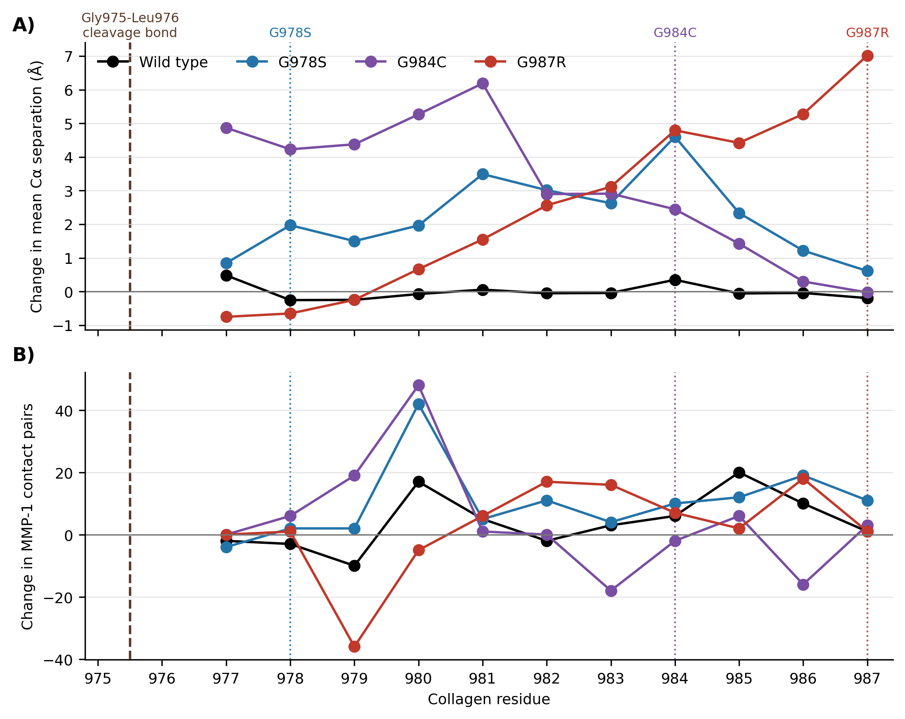
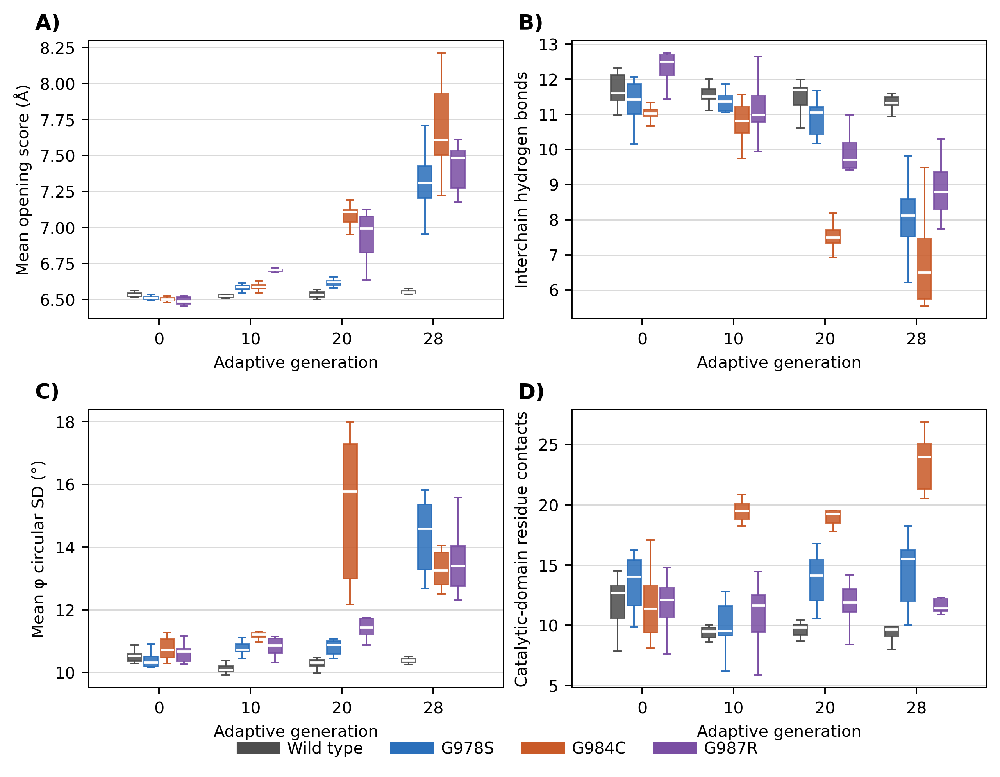

# Osteogenesis imperfecta-associated glycine substitutions encode local triple-helix fragility relevant to MMP-1-mediated matrix remodelling

*Adaptive atomistic molecular dynamics study*

**Anthony Nash¹, Chase Harms¹, Susanta K Sarkar¹**

¹ Arizona State University

**Corresponding author:** Anthony Nash (info@acnash.co.uk)

## Abstract

Osteogenesis imperfecta (OI)-associated collagen glycine substitutions can compromise triple-helical organisation, matrix deposition and extracellular collagen stability, yet the mutation-dependent structural responses that may bias enzymatic matrix remodelling remain incompletely understood. Matrix metalloproteinase 1 (MMP-1) must deform and locally separate collagen chains before cleavage, providing a defined setting in which to examine how clinically motivated substitutions alter the response of a bound triple helix. We therefore used adaptive atomistic molecular dynamics to compare the MMP-1-bound synthetic model collagen homotrimer in PDB 4AUO with three single-chain substitutions: G978S, G984C and G987R. Across generations 0-28, the wild-type selected separation score changed only from 6.897 to 6.890 Å, whereas G978S, G984C and G987R reached 9.030, 9.975 and 9.354 Å, respectively. Analysis of 16,000 uniformly sampled frames showed that this distinction extended beyond selected maxima: generation-28 median worker-mean scores were 6.549 Å for wild type and 7.309-7.611 Å for the substituted systems. The mutation-dependent pathways combined loss of 3.30-4.52 local interchain hydrogen bonds, increased φ/ψ dispersion and reorganisation of collagen-MMP-1 contacts. These findings identify sequence-encoded packing vulnerabilities that could make structurally abnormal collagen engage differently with MMP-1 during extracellular matrix remodelling. They provide a mechanistic framework for testing preferential MMP-1 processing of abnormal collagen, without implying that MMP-1-mediated degradation causes the clinical pathology of OI.

**Keywords:** model collagen peptide  osteogenesis imperfecta-associated mutation  abnormal matrix remodelling  collagen fragility  matrix metalloproteinase 1  adaptive molecular dynamics

## Introduction

Type I collagen is stabilised by a tightly packed triple helix in which glycine occupies every third position. The absence of a glycine side chain permits close packing at the helical centre, whereas substitution introduces a side chain into an environment with little steric tolerance. The resulting changes in packing, hydrogen bonding and chain register contribute to the molecular fragility of collagen in many dominant forms of osteogenesis imperfecta. Importantly, this fragility is heterogeneous: its structural expression depends on both the replacing residue and its position within the collagen sequence [1,2].

The same local packing that supports tissue-bearing collagen must also be deformed during normal matrix turnover. MMP-1 binds the triple helix, separates the chains locally and then cleaves them in succession [3]. An OI-associated substitution could therefore alter not only the structure of collagen in isolation, but also the mechanical response of the triple helix while it is engaged by a remodelling enzyme. In the 4AUO crystal structure, the catalytic and hemopexin domains of MMP-1 contact a synthetic model collagen homotrimer while the scissile bond remains outside productive catalytic geometry [4]. This experimentally resolved complex provides a structurally grounded system in which to compare mutation-dependent responses without assigning the model peptide to a particular native collagen type or patient substrate.

Abnormal extracellular matrix handling of structurally altered collagen has been observed independently of any claim that it explains OI clinical severity. Patient-derived fibroblast matrices can deposit less type I collagen, selectively retain normal over abnormal trimers and lose incorporated mutant collagen more rapidly [12,13]. Separately, type I collagen substitutions close to the canonical collagenase-recognition region have increased cleavage by MMP-1 in vitro, with the greater susceptibility attributed to local triple-helix destabilisation [14]. Together, these observations support a testable matrix-remodelling model in which mutation-encoded fragility can make a collagen population more accessible to enzymatic processing. They do not establish MMP-1 as the dominant protease in OI tissue or enhanced MMP-1 cleavage as a cause of the disease phenotype.

The replacement residue is present during chain synthesis and triple-helix assembly, so the associated packing vulnerability is encoded by the sequence rather than produced during simulation. A substituted peptide can be placed in a closed, wild-type-like starting geometry while nevertheless occupying a different local energy landscape and responding differently to the same mechanical constraint. Near the collagenase-recognition region, such mutation-dependent fragility could alter regional flexibility and the MMP-1-bound conformational pathways available to the substrate. Adaptive sampling was therefore used to reveal accessible local packing-separation pathways, not to model the creation of a defect after assembly.

To compare these responses, ten workers were run per adaptive generation from a common parent with independently generated velocities, and the conformation with the greatest local chain separation initiated the next generation. The substitution set had clinical intent: reported COL1A2 p.Gly772Ser and p.Gly781Arg variants motivated the serine and arginine replacements [9,10], while model G984C was an explicit placement assumption supported at the substitution-class level by patient-derived COL1A1 p.Gly773Cys [11]. We asked whether the three position-residue combinations encoded distinguishable local packing vulnerabilities, how those vulnerabilities altered the collective behaviour of the three collagen chains, and whether their structural expression persisted across workers and frames.

## Results and discussion

### The adaptive campaigns provide a balanced comparison through generation 28

We first established a common comparison interval before examining mutation-dependent behaviour. The analysis comprised generations 0-28 from four separately propagated adaptive lineages, representing 290 completed 20 ns workers for each system, or 5.8 microseconds of aggregate production simulation per system and 23.2 microseconds in total. Approximately 2.32 million separation-score frames contributed to the analysis.

Generation-0 separation scores ranged by only 0.093 Å: 6.897 Å for wild type, 6.829 Å for G978S, 6.804 Å for G984C and 6.832 Å for G987R. This similarity establishes a common value for the selected coordinate at the start of propagation, but it does not imply that the four sequences were equally constrained. The closed starting geometry is a matched structural reference, not a claim that substituted collagen first forms a native-equivalent helix and subsequently becomes fragile. The replacement residues and their altered packing potentials were present from the outset. Their subsequent progression by 2.201-3.170 Å therefore tests how readily each closed structure could access greater local chain separation under the same adaptive protocol. These lineages are directed conformational searches rather than independent equilibrium ensembles.

### Glycine substitutions reveal local packing-separation pathways that are absent from wild type

Wild type remained within a narrow band (Fig. 1A), changing from 6.897 Å at generation 0 to 6.890 Å at generation 28 and never reaching 7 Å. Repeated selection alone therefore did not force progressive chain separation in a sequence that retained glycine at all three tested positions.

Against this stable reference, each glycine substitution expressed its packing vulnerability along a different path. G978S first reached 7 Å at generation 7, passed 8 Å at generation 25 and passed 9 Å at generation 28. G987R reached 7 Å at generation 6, 8 Å at generation 22 and 9 Å at generation 28. G984C also passed 7 Å at generation 6, but its progression accelerated earlier, crossing 8 Å at generation 21, 9 Å at generation 22 and 10 Å at generation 27. At generation 28, the best scores were 9.030 Å for G978S, 9.975 Å for G984C and 9.354 Å for G987R, corresponding to increases of 2.201, 3.170 and 2.522 Å from generation 0. Adaptive selection did not generate these sequence differences. It exposed the greater accessibility of separated local packing states encoded by the substituted peptides, while the absence of comparable progression in wild type shows that the protocol alone was insufficient to produce the response.

*Figure 1  Adaptive local packing separation and worker-level variability. (A) The selection score is the mean of 33 periodic-boundary-corrected distances between corresponding Cα atoms across the three collagen chains for residues 977-987. Each point is the largest score selected from ten 20 ns workers. (B) Distribution of the maximum selection score from each of the ten generation-28 workers. Boxes show the median and interquartile range; whiskers extend to the conventional 1.5 interquartile range limit.*

| System | Generation 0 Å | Generation 28 Å | Change Å | Change percent | First gen ≥ 9 Å |
| --- | --- | --- | --- | --- | --- |
| Wild type | 6.897 | 6.890 | -0.007 | -0.1 | Not reached |
| G978S | 6.829 | 9.030 | +2.201 | +32.2 | 28 |
| G984C | 6.804 | 9.975 | +3.170 | +46.6 | 22 |
| G987R | 6.832 | 9.354 | +2.522 | +36.9 | 28 |

*Table 1  Generation-matched changes in the adaptive collagen separation score.*

### Increased local separation is sustained across frames and parallel workers

The selected maxima establish that the substituted systems can access more separated states, but they do not show whether those states persist beyond isolated frames. We therefore examined the distribution across parallel workers and uniformly sampled production frames. At generation 28, the median worker maximum was 6.833 Å for wild type, 8.773 Å for G978S, 9.851 Å for G984C and 8.485 Å for G987R (Fig. 1B), with respective interquartile ranges of 6.807-6.865, 8.657-8.847, 9.654-9.926 and 8.330-8.724 Å. Across 1,000 uniformly sampled frames per system, mean scores were 6.552 ± 0.076, 7.303 ± 0.467, 7.700 ± 0.625 and 7.460 ± 0.402 Å. The dispersion describes temporal variation among frames, not uncertainty from independent biological replicates. Nevertheless, both levels of analysis distinguish the substituted systems from wild type and show that the response was not confined to one selected conformation.

### The expression of triple-helical fragility depends on the modelled position-residue combination

The three substitutions did not produce a uniform structural phenotype. G984C expressed the earliest large transition and highest score, G978S progressed more slowly, and G987R showed the widest worker-to-worker distribution at generation 28. Because each replacement occupies a different glycine position, these differences resolve distinct position-residue pathways rather than an intrinsic ranking of serine, cysteine and arginine.

Each substitution was present on one chain, whereas the selection score averaged all three pairwise chain separations. A larger mean could therefore arise from several geometries, ranging from displacement of the substituted chain to collective reorganisation of the entire triple helix. To distinguish these possibilities, we examined chain-resolved Cα geometry, hydrogen bonds, backbone dihedrals and MMP-1 contacts in the selected structures. The generation-28 conformations reveal distinct local chain arrangements while the collagen peptide remains associated with MMP-1 (Fig. 2).

*Figure 2  MMP-1-bound collagen structures selected at generation 28. (A) Wild type, with Gly978, Gly984 and Gly987 highlighted; (B) G978S; (C) G984C; and (D) G987R. Structures were reconstructed across periodic boundaries and presented in a common orientation, with the hemopexin domain to the left, the catalytic domain to the right and MMP-1 above the collagen. MMP-1 is shown as a translucent grey cartoon and the three collagen chains as translucent purple cartoons. Highlighted residues are shown as outlined ball-and-stick models, with carbon in cyan, nitrogen in blue, oxygen in red, hydrogen in white and sulfur in yellow.*

Chain-pair decomposition showed that the largest change between the selected generation 0 and 28 structures occurred between the two unmodified chains in every substituted system (Table 2). Their mean separation increased by 3.80 Å in G978S, 6.54 Å in G984C and 4.15 Å in G987R, compared with less than 0.01 Å in wild type. G978S illustrates the asymmetry particularly clearly: chain 1-chain 2 remained effectively closed while both relationships involving chain 3 expanded. The mutation-associated response therefore involved cooperative three-chain rearrangement and cannot be described simply as extrusion of the substituted chain.

| System | Chain 1-chain 2 change Å | Chain 1-chain 3 change Å | Chain 2-chain 3 change Å |
| --- | --- | --- | --- |
| Wild type | +0.08 | -0.11 | +0.00 |
| G978S | -0.09 | +2.89 | +3.80 |
| G984C | +1.03 | +1.94 | +6.54 |
| G987R | +2.21 | +1.21 | +4.15 |

*Table 2  Change in the selected-structure mean Cα separation for each chain pair from generation 0 to generation 28, averaged across residues 977-987.*

### The three substitutions produce distinct patterns of local packing expansion

The chain-pair analysis establishes asymmetry, but a complementary measure is needed to describe the cross-sectional response of all three chains together. The triangular area enclosed by the three corresponding Cα atoms provides such a measure without privileging one chain pair. In the selected generation-parent structures, the mean area across residues 977-987 changed from 17.23 to 17.58 Ų in wild type between generations 0 and 28 (Fig. 3). The equivalent changes were from 17.53 to 27.40 Ų for G978S, 16.81 to 33.13 Ų for G984C and 17.17 to 37.20 Ų for G987R. The local Cα radius of gyration increased by 0.14 Å in wild type, compared with 0.72, 1.18 and 0.65 Å for G978S, G984C and G987R, respectively. After least-squares alignment of all 33 window Cα atoms to the generation 0 structure, the local Cα root-mean-square displacement at generation 28 was 0.82 Å for wild type and 2.67-3.67 Å for the substituted systems. Together, these measures show that the selection score reports reorganisation of local three-chain packing rather than uniform translation of the peptide.

The cross-sectional expansion was also distributed differently along the sequence (Fig. 4A). G978S produced its largest increase at residue 984, where the mean separation increased by 4.60 Å, and affected the central part of the analysed window more strongly than either terminus. G984C produced its largest response on the amino-terminal side of the substitution, with increases of 4.23-6.19 Å across residues 977-981 and a maximum at Gly981. G987R instead showed an increasingly strong carboxy-terminal response, culminating in a 7.02 Å increase at the substituted residue. These selected structures suggest that the spatial expression of packing fragility differs among the three modelled systems. They do not by themselves establish temporal propagation, and separating residue-identity effects from sequence-position effects would require a factorial set of substitutions.

*Figure 3  Structural changes in the selected frame from each adaptive generation. (A) Periodic-boundary-corrected local separation score. (B) Interchain hydrogen bonds in which both residues lie within collagen positions 977-987. (C) Mean area of the triangle formed by corresponding Cα atoms across the three collagen chains. (D) Number of MMP-1-collagen heavy-atom pairs within 4.5 Å. The same selected structure was used for all four measurements.*

### Sequence-encoded fragility is accompanied by hydrogen-bond loss and conformational broadening

Having established mutation-dependent changes in packing geometry, we next asked whether they were accompanied by loss of local interchain constraints. Wild-type collagen retained 12 of the 13 interchain hydrogen bonds initially present within residues 977-987 in the generation-28 selected structure. G978S decreased from 9 to 7 bonds, G984C from 10 to 5 and G987R from 11 to 5. Because one endpoint can be sensitive to local fluctuations, we also compared the selected structures from generations 0-4 and 24-28. The wild-type mean changed from 12.8 to 11.0 bonds, whereas the corresponding values decreased from 10.6 to 6.8 for G978S, 10.2 to 3.6 for G984C and 13.2 to 7.4 for G987R. Across the selected structures, the correlation between the separation score and local interchain hydrogen-bond count was -0.61 for G978S, -0.86 for G984C and -0.71 for G987R, compared with 0.04 for wild type. These descriptive correlations follow intentionally selected high-separation structures and are not estimates from independent equilibrium samples.

The chain-resolved hydrogen-bond pattern explains why the geometric response cannot be assigned solely to the substituted chain. Bonds between chains 2 and 3 changed from an early-generation mean of 4.8 to 4.2 in wild type, but decreased from 4.2 to 0.4 in G978S, from 4.2 to 0.0 in G984C and from 4.8 to 0.8 in G987R. Although the substitutions were introduced on chain 1, the most consistent loss of interchain constraint occurred between the two unmodified chains. The packing response therefore involved cooperative reorganisation across the triple helix rather than isolated displacement of the substituted chain.

Loss of interchain constraint was accompanied by broader backbone sampling over the same interval. Between generations 0-4 and 24-28, the circular standard deviation of φ/ψ angles within residues 977-987 changed by only 1.0°/0.5° in wild type. It increased by 4.2°/8.0° for G978S, 15.2°/12.2° for G984C and 14.7°/15.9° for G987R. Changes in ω dispersion were smaller, ranging from -0.3° to 1.2° in the substituted systems. The mutation-associated fragility was therefore expressed as broader local backbone sampling coupled to progressive loss of interchain constraint, rather than widespread distortion of the peptide bond. Hydrogen-bond loss is treated as a structural correlate of this pathway, not as its sole initiating cause.

### Local packing separation reorganises the collagen-MMP-1 interface

The changes within the triple helix occurred while collagen remained closely associated with MMP-1, raising the question of whether local packing separation weakened the interface or reorganised it. Heavy-atom contact counts did not decrease as the adaptive pathways progressed (Fig. 3D). Mean counts over generations 0-4 and 24-28 increased from 195.8 to 226.2 for G978S, 155.0 to 252.6 for G984C, 147.0 to 191.4 for G987R and 157.8 to 177.2 for wild type. Minimum collagen-MMP-1 separation remained close to 2.7 Å, indicating persistent association through a redistributed contact network.

The redistribution was residue-specific (Fig. 4B): G978S gained contacts mainly across residues 980-987, G984C gained them at residues 977-980 while losing them at 982-985, and G987R gained them across residues 982-987. Because this heavy-atom-pair metric is sensitive to residue size, it does not measure binding affinity or establish productive catalytic geometry. It shows more narrowly that mutation-dependent packing changes can alter the local enzyme-substrate interface without eliminating close contact.

*Figure 4  Residue-resolved structural changes from generation 0 to generation 28. (A) Change in the mean of the three pairwise Cα separations at each collagen position. (B) Change in the number of collagen-MMP-1 heavy-atom contact pairs, summed across the three collagen chains. Positive values indicate increased separation or contact number at generation 28.*

### Trajectory-wide analysis confirms a sustained mutation-dependent packing response

The selected structures define the accessible endpoints of each adaptive generation, but a sustained mutation-dependent response should also be evident within the underlying production trajectories. We therefore analysed every worker at generations 0, 10, 20 and 28 using 100 uniformly spaced production frames per worker. The resulting dataset comprised 16,000 frames from 160 workers, with complete coverage and no missing metric values. The worker-mean separation score remained nearly unchanged in wild type: the median across ten workers was 6.534 Å at generation 0 and 6.549 Å at generation 28 (Fig. 5A). The corresponding medians increased from 6.512 to 7.309 Å for G978S, from 6.502 to 7.611 Å for G984C and from 6.488 to 7.482 Å for G987R. At generation 28, the interquartile ranges were 6.544-6.559 Å for wild type, 7.206-7.429 Å for G978S, 7.503-7.929 Å for G984C and 7.276-7.534 Å for G987R. The progression identified from selected frames was therefore expressed across the production trajectories of all parallel workers rather than being confined to isolated maxima.

The accompanying loss of interchain hydrogen bonds was similarly sustained. Using a 3.5 Å donor-acceptor cut-off and a 135° minimum donor-hydrogen-acceptor angle, median worker means changed from 11.60 to 11.33 bonds in wild type, from 11.42 to 8.12 in G978S, from 11.02 to 6.50 in G984C and from 12.50 to 8.78 in G987R (Fig. 5B). The same ordering was obtained with a stricter 3.2 Å distance criterion and with minimum angles of 120° and 150°. Backbone-only counts decreased by 2.73-3.63 bonds in the substituted systems but increased by 0.14 bonds in wild type. The result therefore does not depend on a single geometric definition or on the inclusion of side-chain donors and acceptors.

The dihedral statistics provided a third, independent description of this response. From generation 0 to 28, median worker-averaged φ circular standard deviations changed from 10.52° to 10.37° in wild type, but increased from 10.32° to 14.59° in G978S, from 10.71° to 13.25° in G984C and from 10.66° to 13.40° in G987R (Fig. 5C). The corresponding ψ values changed from 9.95° to 9.90° in wild type and increased to 14.93°, 12.79° and 11.44° in G978S, G984C and G987R. Increases on multiple chains show that the mutation-associated fragility was expressed as collective triple-helix flexibility rather than motion confined to the substituted chain.

This collective response remained coupled to the enzyme interface. At generation 28, median catalytic-domain residue contacts were 9.67 in wild type, 15.52 in G978S, 23.98 in G984C and 11.42 in G987R (Fig. 5D); hemopexin-domain medians were 21.28-25.15. Local packing separation therefore redistributed the interface, particularly for G984C, without detaching collagen from MMP-1.

Because zinc coordination is represented by bonded interactions in this model, coordination distances are not interpreted as evidence for active-site stability. We used the catalytic zinc only as a geometric reference for substrate placement. At generation 28, the median worker-mean distance from the nearest Gly975 scissile carbon to this reference was 9.24 Å in wild type and 10.30-12.20 Å in the substituted systems, and no sampled generation-28 frame gave a value below 7.64 Å. The simulations therefore resolve local packing and interface reorganisation without supporting a claim of catalytic engagement or cleavage.

*Figure 5  Analysis of all ten workers at generations 0, 10, 20 and 28. Each worker contributes 100 production frames sampled at 200 ps intervals; boxes summarise worker means. (A) Local separation score. (B) Interchain hydrogen bonds within residues 977-987 using a 3.5 Å donor-acceptor cut-off and 135° minimum donor-hydrogen-acceptor angle. (C) Mean φ circular standard deviation across the analysed residues and chains. (D) Unique collagen-MMP-1 residue contacts assigned to the catalytic domain. Boxes show the median and interquartile range; whiskers extend to the conventional 1.5 interquartile range limit.*

| System | Separation change Å | H-bond change | φ SD change ° | ψ SD change ° | Catalytic-contact change |
| --- | --- | --- | --- | --- | --- |
| Wild type | +0.015 | -0.28 | -0.16 | -0.04 | -3.00 |
| G978S | +0.797 | -3.30 | +4.27 | +5.39 | +1.49 |
| G984C | +1.109 | -4.52 | +2.55 | +2.63 | +12.61 |
| G987R | +0.995 | -3.72 | +2.74 | +1.46 | -0.69 |

*Table 3  Difference between generation 28 and generation 0 medians of the ten worker means. Hydrogen bonds use the 3.5 Å/135° criterion. Dihedral values are mean residue- and chain-specific circular standard deviations.*

### Adaptive selection reveals mutation-dependent pathway accessibility

The campaign was designed to locate local packing-separation routes rather than measure their equilibrium populations. Each generation inherited the most separated preceding structure, so generations are genealogically related and workers are conditional on previous selection. Frame frequencies therefore cannot be converted into free-energy differences or analysed as independent observations. Within this scope, the matched protocol remains informative: wild type resisted directional change, whereas every substituted sequence reached states absent from wild type despite generation-0 scores spanning only 0.093 Å. The altered packing potentials existed before adaptive propagation began. Selection therefore revealed mutation-dependent differences in pathway accessibility; it did not produce the molecular fragility. The data describe the structural expression of sequence-encoded flexibility, not equilibrium stability or collagenolytic rates.

### Implications for abnormal MMP-1-mediated matrix remodelling

The present results are most directly interpreted at the level of enzyme-substrate remodelling rather than disease causation. Structurally abnormal collagen has been shown to undergo inefficient matrix deposition and preferential extracellular loss [12,13], while patient-derived substitutions near a collagenase-recognition region can increase susceptibility to MMP-1 cleavage [14]. Our simulations provide a structural bridge between those observations: the substituted model peptides accessed local chain-separated states, lost interchain constraints and reorganised their MMP-1 contacts in ways that remained inaccessible to wild type under the same protocol.

This supports the hypothesis that mutation-encoded triple-helical fragility can bias MMP-1 interactions towards abnormal matrix remodelling. It does not show that MMP-1 performed cleavage in these simulations, that MMP-1 is responsible for preferential mutant-collagen loss in tissue, or that such loss produces OI pathology. Establishing those steps will require direct kinetic comparison of wild-type and mutant full-length collagen, followed by fibrillar and cell-derived matrix experiments that distinguish MMP-1 from other collagenolytic proteases. The mechanistic contribution of this study is therefore a tractable structural explanation for differential substrate susceptibility, not a causal model of the clinical disease.

## Conclusions

Adaptive molecular dynamics revealed mutation-dependent local triple-helical fragility encoded by OI-associated glycine substitutions in MMP-1-bound model collagen. Although all four systems began from similar separation scores, each substituted peptide accessed a distinct local packing pathway that remained inaccessible to wild type, with G984C producing the earliest and largest response. This fragility was expressed collectively through three-chain expansion, loss of interchain hydrogen bonds, broader φ/ψ sampling and redistribution of collagen-MMP-1 contacts across workers and frames. The simulations therefore connect sequence variation to a structural response that could favour differential MMP-1 processing during extracellular matrix remodelling. This interpretation is consistent with experimental reports of selective mutant-collagen loss from matrix and enhanced MMP-1 cleavage of locally destabilised type I collagen [12-14]. Because the systems are synthetic model peptides sampled through adaptive lineages, they do not establish catalytic engagement, collagenolytic rate, preferential degradation in tissue or a causal contribution to OI pathology.

## Methods

### MMP-1 collagen systems

The starting complex was based on PDB 4AUO, which contains human MMP-1 bound to a 40-residue synthetic homotrimeric model collagen peptide [4]. The peptide contains a collagenase-recognition region and terminal Gly-Pro-Hyp repeats that stabilize its triple-helical structure. It is used here as a general model collagen substrate and is not assigned to a particular native collagen type. The collagen register follows the numbering assigned in the prepared topology. The scissile Gly-Leu bond is Gly975-Leu976, and the analysed window at residues 977-987 corresponds to the P2′-P12′ region. The G978S, G984C and G987R models therefore place substitutions at P3′, P9′ and P12′, respectively; these numbers are model-peptide coordinates rather than COL1A1 or COL1A2 HGVS positions. The deposited crystallographic enzyme contains the inactive E200A substitution. The prepared simulation topology instead contains a deprotonated GLU residue at position 200 and explicit structural and catalytic zinc ions. Zinc coordination is represented by bonded interactions to the coordinating residues. The repository does not contain the original A200E coordinate-reconstruction record, so the exact rebuilding method and initial Glu200 rotamer cannot be recovered from the current provenance.

Four model collagen systems were prepared: the unmodified 4AUO peptide sequence and G978S, G984C and G987R substitutions. Each substitution was introduced on collagen chain 1 only; the corresponding positions on chains 2 and 3 remained glycine. Selection of the substitution set was clinically motivated. COL1A2 c.2314G>A, p.Gly772Ser is classified as pathogenic or likely pathogenic and has been reported in patients with osteogenesis imperfecta [9]. COL1A2 c.2341G>C, p.Gly781Arg has likewise been identified as a pathogenic variant in affected patients [10]. These observations provided the patient-variant references for the serine and arginine choices. The substitutions were placed within the collagenase-recognition region of the 4AUO model peptide, whose coordinate register and homotrimeric sequence differ from native type I collagen; G978S and G987R are therefore clinically motivated model placements rather than direct HGVS equivalents of p.Gly772Ser and p.Gly781Arg.

No exact patient variant corresponding to model G984C was identified during system design. Its inclusion was an explicit assumption that a glycine-to-cysteine replacement in the local 4AUO recognition region would provide a clinically relevant chemical comparator. This assumption is supported at the substitution-class level by the reported de novo COL1A1 c.2317G>T, p.Gly773Cys variant in a patient with severe osteogenesis imperfecta [11], but that clinical observation does not establish model G984C as the same positional variant. The calculations should consequently be interpreted as simulations of three clinically motivated substitutions in a synthetic model collagen homotrimer, with direct patient-variant support for the serine and arginine choices and an explicitly assumed local placement for cysteine.

Each complex was represented with the Amber99SB-ILDN protein force field [5] and TIP3P water [6]. The supplied topology includes explicit hydroxyproline parameters and a bonded model for both zinc sites. Mutant side-chain coordinates were constructed on chain 1 by transferring a residue template into the target backbone frame and searching side-chain rotations to improve the minimum heavy-atom separation from the surrounding structure. G984C was represented as a neutral, protonated thiol and no disulfide bond was introduced. Systems were neutralised and supplemented with 57 sodium-chloride pairs to a target concentration of 150 mM. The final wild-type, G978S and G984C systems contained 18,745 water molecules, 57 sodium ions and 67 chloride ions. G987R contained 18,744 water molecules, 57 sodium ions and 68 chloride ions because the arginine substitution changed the system charge.

Initial short validation showed that G978S could be stabilised using a 0.5 fs timestep, whereas the initial G984C and G987R structures developed non-finite coordinates and required additional OpenMM-only relaxation. All three mutant starting structures subsequently underwent 10 ps NVT and 10 ps NPT at 312.5 K with a 2 fs timestep before the adaptive campaigns. The wild-type campaign began from the prepared 150 mM structure without this mutant-specific rescue history. The preparation histories therefore differed, but the generation 0 separation scores were 6.897, 6.829, 6.804 and 6.832 Å for wild type, G978S, G984C and G987R, respectively. Their 0.093 Å range shows that the different side-chain sizes and preparation routes did not produce a meaningful initial offset in the selection coordinate. Preparation history may still affect unmeasured coordinates, but the observed starting equivalence argues against it as the origin of the subsequent multi-ångström separation differences.

### Molecular dynamics protocol

Simulations were performed with OpenMM 8 [7]. Long-range electrostatics were evaluated using particle mesh Ewald summation [8] with a 1.0 nm real-space cut-off. Bonds involving hydrogen were constrained and water molecules were rigid. A Langevin middle integrator maintained the temperature at 310.15 K with a friction coefficient of 1 ps-1 and a 2 fs time step. Pressure was maintained at 1 bar with a Monte Carlo barostat attempted every 25 integration steps. CUDA mixed precision was used for production simulations.

Generation 0 of each adaptive campaign began with energy minimisation for up to 500 iterations, followed by 50 ps in the NVT ensemble and 200 ps in the NPT ensemble. Each worker then completed 20 ns of NPT production simulation. Frames and local separation scores were recorded every 10 ps. Production checkpoints were written every 200 ps. Ten valid workers were required for a completed generation. Random seeds were derived deterministically from a master seed of 90210, the generation number, worker number and retry attempt.

### Adaptive selection

The adaptive selection region comprised residues 977-987 on each of the three collagen chains. At each recorded frame, minimum-image distances were calculated between corresponding Cα atoms for chain pairs 1-2, 1-3 and 2-3. The selection score was the mean of these 33 distances. This coordinate measures local interchain separation and does not by itself establish complete triple-helical unwinding. Periodic-boundary correction prevented molecular imaging from being mistaken for structural separation. The highest-scoring frame across the ten completed workers was retained as the parent for the next generation.

All ten workers in subsequent generations began from the selected parent coordinates. Parent-seeded generations skipped minimisation to preserve the selected geometry, then completed the same 50 ps NVT and 200 ps NPT equilibration stages. Velocities were generated stochastically and scaled, within predefined limits of 0.5-2.0, to match the kinetic energy of the parent when that energy was available. The procedure then repeated until the campaign stopped or reached its target generation.

### Adaptive separation data analysis

The joint report contained frame-level separation scores, worker summaries and generation summaries. We calculated changes from generation 0 to generation 28, the first generation at which each system crossed 7, 8, 9 and 10 Å, descriptive progression across generations 0-28, distributions of worker maxima and frame-level means and standard deviations. The frame table was processed in chunks and only completed or approximately completed workers were included in frame aggregates. No inferential p values were calculated because workers within a generation share a structural parent and successive generations share an adaptively selected lineage.

### Structural and hydrogen-bond analysis

The highest-scoring frame selected from each completed generation was analysed after reconstructing the MMP-1 and three collagen molecule ranges from the GROMACS topology. Structural comparisons covered generations 0-28. All distances and angles were calculated using minimum-image periodic boundary conditions. For residues 977-987, we calculated the three pairwise Cα separations, the area of the Cα triangle, distance asymmetry, local Cα radius of gyration and the root-mean-square displacement after least-squares alignment of all 33 window Cα atoms to the corresponding generation 0 atoms. MMP-1 contacts were defined as collagen-MMP-1 heavy-atom pairs separated by no more than 4.5 Å. Because this metric counts atom pairs rather than unique residue pairs, absolute values are influenced by residue size and are interpreted only as selected-structure contact context.

Collagen hydrogen bonds were assigned using a donor-acceptor distance of no more than 3.5 Å and a donor-hydrogen-acceptor angle of at least 120°. A hydrogen atom was assigned to a donor heavy atom within 1.25 Å in the same residue. Bonds were classified as interchain or intrachain, and the local analysis included interchain bonds for which both residues mapped to positions 977-987. Backbone φ, ψ and ω angles were calculated for consecutive collagen residues and summarised using circular statistics. We compared generation 0 with generation 28 and summarised the selected structures over generations 0-4 and 24-28. These operations do not remove high-separation selection bias. Correlations with the separation score are descriptive because successive generations share an adaptively selected lineage.

### Trajectory-wide worker analysis

Existing production trajectories from generations 0, 10, 20 and 28 were analysed for all ten workers in each system. Every twentieth stored frame was retained, giving a nominal 200 ps sampling interval and 100 frames per 20 ns worker. The final dataset comprised 16,000 frames from 160 workers. The local separation score, three chain-pair distances, Cα triangle area and distance asymmetry were calculated with minimum-image periodic boundary conditions. Interchain hydrogen bonds within residues 977-987 were counted under four prespecified criteria: donor-acceptor distances of 3.2 or 3.5 Å with a minimum donor-hydrogen-acceptor angle of 120°, and the 3.5 Å cut-off with minimum angles of 135° or 150°. Backbone-only bonds were also counted separately.

Unique collagen-MMP-1 residue contacts were defined by at least one heavy-atom distance of no more than 4.5 Å and assigned to the catalytic domain, linker or hemopexin domain according to MMP-1 residue number. Residue- and chain-specific φ, ψ and ω distributions were summarised by circular means and circular standard deviations. Because metal coordination is bonded in the simulation topology, zinc-ligand distances were used only as internal geometric checks and not as evidence of active-site stability. Chain-specific distances from the Gly975-Leu976 scissile region to the catalytic zinc and Glu200 were used to describe substrate placement. Each worker was first reduced to its trajectory mean; medians and interquartile ranges were then calculated across the ten workers at each system-generation combination. These summaries are descriptive. Workers share a generation parent and generations form a selected lineage, so no hypothesis tests treating them as independent replicates were performed.

### Scope and limitations

The study contains one adaptively propagated lineage per system and locates local packing-separation routes rather than equilibrium populations; genealogical dependence precludes conventional replicate-based significance tests. The selection coordinate measures local interchain Cα separation, not complete triple-helical unwinding. Although 4AUO provides an experimentally resolved MMP-1-bound starting geometry, its finite synthetic homotrimer does not reproduce the heterotrimeric, fibrillar or tissue context of native type I collagen. Serine and arginine have identifiable clinical motivation, but their model positions are not direct HGVS equivalents; the cysteine placement is an explicit modelling assumption supported by a nearby glycine-to-cysteine patient variant. Preparation histories differed, although the 0.093 Å range in generation-0 scores argues against an initial separation bias; effects on unmeasured coordinates remain possible. Close MMP-1 contact does not establish catalytic competence, and the scissile region remained outside a productive geometry. No claim is made that MMP-1 cleaved these substrates, drives abnormal matrix turnover in vivo or contributes causally to OI clinical pathology.

## Data and code availability

Simulation preparation, adaptive sampling and structural-analysis code are available at https://github.com/acnash/mmp1-collagen-oi-adaptive-md. The analyses reported here correspond to repository commit `4938facd4312ce5c4528245f1ca035937697a9f0`. A versioned release and immutable data archive with checksums will be created for submission.

## References

1. Xiao J, Cheng H, Silva T, Baum J, Brodsky B. Osteogenesis imperfecta missense mutations in collagen: structural consequences of a glycine to alanine replacement at a highly charged site. Biochemistry. 2011;50:10771-10780. doi:10.1021/bi201476a.

2. Clements KA, Acevedo-Jake AM, Walker DR, Hartgerink JD. Glycine substitutions in collagen heterotrimers alter triple helical assembly. Biomacromolecules. 2017;18:617-624. doi:10.1021/acs.biomac.6b01808.

3. Chung L, Dinakarpandian D, Yoshida N, Lauer-Fields JL, Fields GB, Visse R, Nagase H. Collagenase unwinds triple-helical collagen prior to peptide bond hydrolysis. EMBO J. 2004;23:3020-3030. doi:10.1038/sj.emboj.7600318.

4. Manka SW, Carafoli F, Visse R, Bihan D, Raynal N, Farndale RW, Murphy G, Enghild JJ, Hohenester E, Nagase H. Structural insights into triple-helical collagen cleavage by matrix metalloproteinase 1. Proc Natl Acad Sci USA. 2012;109:12461-12466. doi:10.1073/pnas.1204991109.

5. Lindorff-Larsen K, Piana S, Palmo K, Maragakis P, Klepeis JL, Dror RO, Shaw DE. Improved side-chain torsion potentials for the Amber ff99SB protein force field. Proteins. 2010;78:1950-1958. doi:10.1002/prot.22711.

6. Jorgensen WL, Chandrasekhar J, Madura JD, Impey RW, Klein ML. Comparison of simple potential functions for simulating liquid water. J Chem Phys. 1983;79:926-935. doi:10.1063/1.445869.

7. Eastman P, Galvelis R, Peláez RP, et al. OpenMM 8: molecular dynamics simulation with machine learning potentials. J Phys Chem B. 2024;128:109-116. doi:10.1021/acs.jpcb.3c06662.

8. Darden T, York D, Pedersen L. Particle mesh Ewald: an N log N method for Ewald sums in large systems. J Chem Phys. 1993;98:10089-10092. doi:10.1063/1.464397.

9. Zhytnik L, Maasalu K, Pashenko A, Khmyzov S, Reimann E, Prans E, Kõks S, Märtson A. COL1A1/2 pathogenic variants and phenotype characteristics in Ukrainian osteogenesis imperfecta patients. Front Genet. 2019;10:722. doi:10.3389/fgene.2019.00722.

10. Coetzer KC, Zöllner E, Moosa S. Genetic basis of osteogenesis imperfecta from a single tertiary centre in South Africa. Eur J Hum Genet. 2024;32:1285-1290. doi:10.1038/s41431-023-01509-3.

11. Maasalu K, Nikopensius T, Kõks S, Nõukas M, Kals M, Prans E, Zhytnik L, Metspalu A, Märtson A. Whole-exome sequencing identifies de novo mutation in the COL1A1 gene to underlie severe osteogenesis imperfecta. Hum Genomics. 2015;9:6. doi:10.1186/s40246-015-0028-0.

12. Cetta G, Rossi A, Tenni R, Valli M, Forlino A, Zanaboni G, Dyne K, Burgio GR. Deposition of mutant type I collagen in the extracellular matrix of cultured dermal fibroblasts in osteogenesis imperfecta. Connect Tissue Res. 1993;29:41-49. doi:10.3109/03008209309061965.

13. Bateman JF, Golub SB. Deposition and selective degradation of structurally-abnormal type I collagen in a collagen matrix produced by osteogenesis imperfecta fibroblasts in vitro. Matrix Biol. 1994;14:251-262. doi:10.1016/0945-053X(94)90189-9.

14. Pace JM, Wiese M, Drenguis AS, Kuznetsova N, Leikin S, Schwarze U, Chen D, Mooney SH, Unger S, Byers PH. Substitutions for arginine at position 780 in the triple helical domain of the alpha1(I) chain alter folding of the type I procollagen molecule and cause osteogenesis imperfecta. PLoS One. 2018;13:e0200264. doi:10.1371/journal.pone.0200264.
