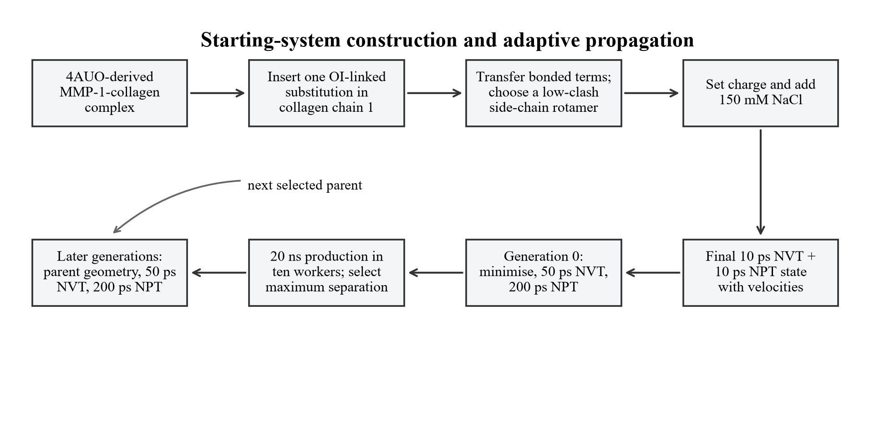
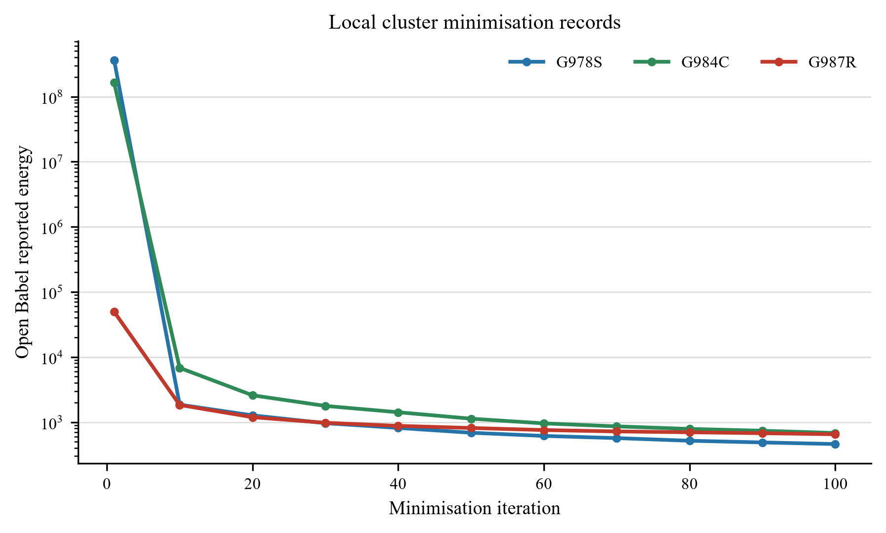
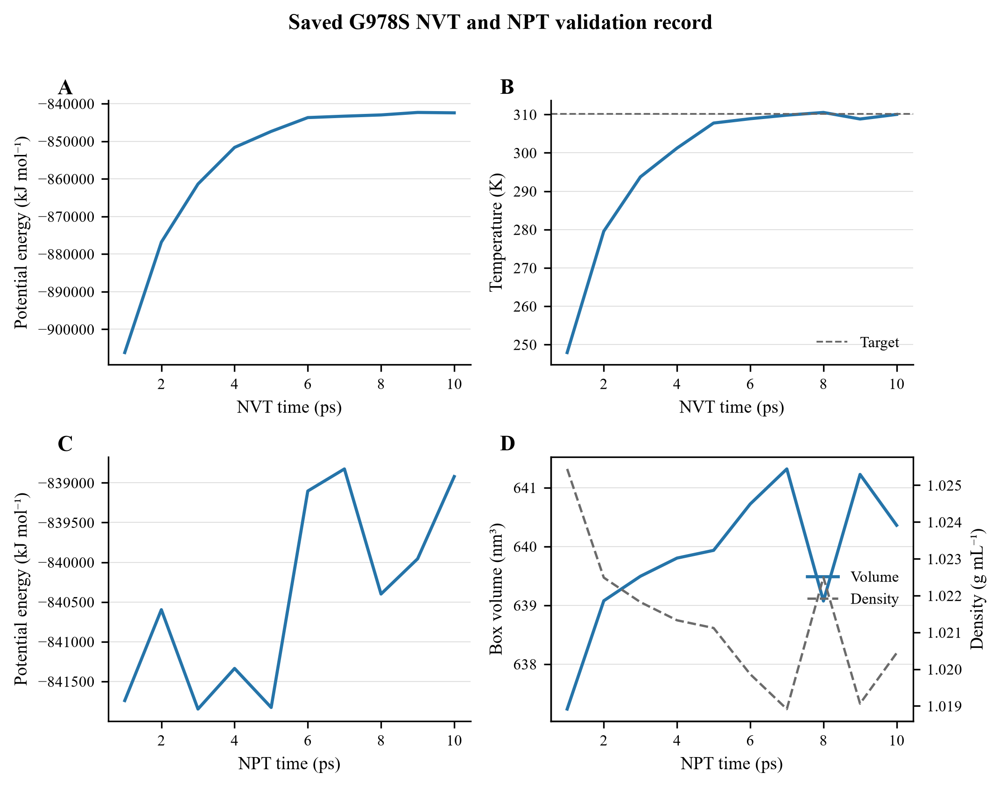
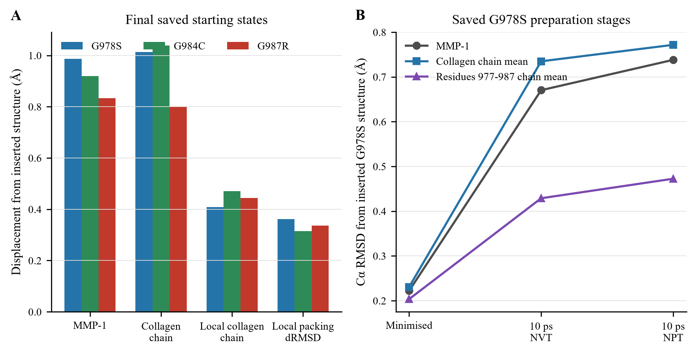
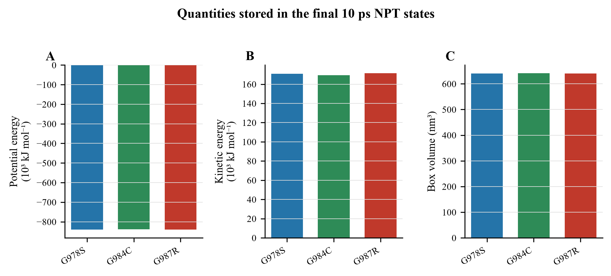

# Osteogenesis imperfecta-associated glycine substitutions encode local triple-helix packing vulnerability relevant to MMP-1-mediated matrix remodelling

*Supplementary Information*

**Anthony Nash¹, Chase Harms¹, Susanta K Sarkar¹**

¹ Arizona State University

**Corresponding author:** Anthony Nash (info@acnash.co.uk)

## Supplementary overview

This Supplementary Information describes the construction and relaxation of the MMP-1-bound collagen systems used for adaptive molecular dynamics. It details how the three glycine substitutions were inserted, how charge and salt composition were set, and how minimisation, NVT and NPT stages were applied before and during adaptive propagation. A complete short thermodynamic time series is presented for G978S, while final coordinate, velocity and OpenMM state files permit structural and endpoint comparisons across all three substituted systems. Every adaptive generation subsequently underwent 50 ps NVT and 200 ps NPT relaxation before its 20 ns production simulation.

## Supplementary Methods

### System preparation workflow

System construction used a scripted workflow that generated the mutant collagen topology and coordinates, adjusted the ionic composition and produced complete GROMACS include sets for OpenMM. Local cluster minimisation was used to inspect the inserted side-chain geometry before full-system relaxation. The resulting solvated systems were then prepared through OpenMM minimisation, NVT and NPT stages, followed by the common generation-0 relaxation applied by the adaptive runner.

### Starting complex and collagen register

The starting complex was derived from PDB 4AUO, which contains human MMP-1 bound to a synthetic homotrimeric collagen peptide [1]. The prepared topology uses the model-peptide residue register. The Gly975-Leu976 bond represents the scissile bond, and residues 977-987 correspond to the P2′-P12′ region analysed in the adaptive campaign. The deposited enzyme contains the inactive E200A substitution. The prepared simulation system contains Glu200, explicit structural and catalytic zinc ions and bonded interactions between each zinc ion and its coordinating residues.

The wild-type system retained the 4AUO model-peptide sequence. G978S, G984C and G987R were introduced into collagen chain 1, while the corresponding positions in chains 2 and 3 remained glycine. These labels follow the prepared model-peptide coordinates and are distinct from native COL1A1 and COL1A2 HGVS numbering.

### Construction of the substituted collagen chains

The mutant-building script replaced the topology and coordinates of one glycine residue in the first collagen chain. Backbone N, Cα, C and O coordinates were retained from the target glycine where corresponding atoms were available. Donor side-chain coordinates were transferred into the target N-Cα-C reference frame. The script then searched side-chain rotations in 60° increments and selected the orientation that maximised the minimum heavy-atom distance from the surrounding structure. One torsion was searched for serine and cysteine, while three successive side-chain torsions were searched for arginine.

Topology construction preserved interactions that could be mapped through the retained backbone atoms and transferred residue-specific bonded terms from the donor template. The serine template was obtained from MMP-1 Ser123, and the arginine template was obtained from collagen Arg989. Cysteine used explicit Amber-compatible atom types, charges and masses for a neutral protonated thiol. The SG-HG bond, associated angles, pair terms and dihedrals were added explicitly. No disulphide bond was introduced in G984C.

| System | Target on collagen chain 1 | Side-chain source | Charge treatment |
| --- | --- | --- | --- |
| G978S | Gly978 to Ser978 | MMP-1 Ser123 residue template | No change to the system ion count |
| G984C | Gly984 to Cys984 | Explicit neutral protonated cysteine template | No disulphide bond; no change to the system ion count |
| G987R | Gly987 to Arg987 | Collagen Arg989 residue template | One water replaced by chloride to compensate for the added positive charge |

*Table S1  Construction of the three substituted collagen chains.*

### Solvation, charge and ionic strength

The prepared complexes used the Amber99SB-ILDN protein force field [2], the supplied hydroxyproline and bonded zinc parameters, and TIP3P water [3]. Water molecules were replaced with 57 sodium-chloride pairs to target 150 mM NaCl in the approximately 636 nm³ starting box. Existing neutralising chloride ions were retained. The arginine substitution required one additional chloride ion and one fewer water molecule.

| System | Water molecules | Sodium ions | Chloride ions | Starting box volume, nm³ |
| --- | ---: | ---: | ---: | ---: |
| Wild type | 18,745 | 57 | 67 | 636.071 |
| G978S | 18,745 | 57 | 67 | 636.071 |
| G984C | 18,745 | 57 | 67 | 636.071 |
| G987R | 18,744 | 57 | 68 | 636.071 |

*Table S2  Composition of the salted starting systems.*

### Local cluster minimisation records

Each substituted residue was examined in a local cluster using 100 steps of Open Babel minimisation [4]. The reported energy declined from 3.62 × 10⁸ to 460.3 for G978S, from 1.63 × 10⁸ to 680.7 for G984C and from 4.95 × 10⁴ to 650.8 for G987R (Fig. S2). Open Babel reports these values in its internal force-field energy units, so the curves were used to assess local side-chain relaxation and were not compared quantitatively with OpenMM potential energies. The solvated complexes were subsequently relaxed as complete systems in OpenMM.

### OpenMM validation and final preparation

OpenMM 8 was used with particle mesh Ewald electrostatics, a 1.0 nm real-space cut-off, constraints on bonds involving hydrogen, rigid water and a Langevin middle integrator [5,6]. The initial validation protocol comprised full-system energy minimisation followed by 10 ps NVT and 10 ps NPT. G978S completed this protocol at 310.15 K with a 0.5 fs time step after the original 2 fs start proved unstable. The NPT stage used a 1 bar Monte Carlo barostat. Coordinates were saved after minimisation, after NVT and after NPT, and thermodynamic quantities were reported every 1 ps.

G984C and G987R required additional OpenMM relaxation before the final common preparation. The common final script ran 10 ps NVT and 10 ps NPT at 312.5 K with a 2 fs time step, generated new thermal velocities at the start of NVT, carried those velocities into NPT and saved the final coordinate, velocity, serialized state and checkpoint files. Generation 0 then placed every system under the production target conditions of 310.15 K and 1 bar. Time-resolved short-validation analysis was restricted to G978S, for which coordinates and reporter data were available after minimisation, NVT and NPT. Cross-system comparisons used the final velocity-bearing coordinates and serialized states.

| System | Preliminary preparation | Final common preparation | Adaptive generation 0 |
| --- | --- | --- | --- |
| G978S | Minimisation, 10 ps NVT and 10 ps NPT at 310.15 K with 0.5 fs steps | 10 ps NVT and 10 ps NPT at 312.5 K with 2 fs steps | Minimisation, 50 ps NVT and 200 ps NPT at 310.15 K and 1 bar |
| G984C | Additional staged OpenMM relaxation | 10 ps NVT and 10 ps NPT at 312.5 K with 2 fs steps | Minimisation, 50 ps NVT and 200 ps NPT at 310.15 K and 1 bar |
| G987R | Additional staged OpenMM relaxation | 10 ps NVT and 10 ps NPT at 312.5 K with 2 fs steps | Minimisation, 50 ps NVT and 200 ps NPT at 310.15 K and 1 bar |

*Table S3  Preparation sequence applied to each substituted system before production.*

### Relaxation within the adaptive workflow

The preparation endpoint was not passed directly into a production trajectory without further relaxation. Generation 0 assigned fresh Maxwell-Boltzmann velocities at 310.15 K, performed energy minimisation for up to 500 iterations, ran 50 ps NVT and then ran 200 ps NPT at 1 bar before beginning the 20 ns production simulation (Fig. S1). Ten workers were run in each generation.

For every later generation, the selected parent coordinates and periodic box were loaded from the preceding production simulation. The current runner skips a second minimisation for these parent-seeded generations, because the coordinates had already been sampled during production, and applies 50 ps NVT followed by 200 ps NPT before the next 20 ns production segment. Parent kinetic energy is stored with the selected frame. Each child worker receives independently drawn stochastic velocities that are rescaled to match the parent kinetic energy when the required scale factor lies between 0.5 and 2.0. The velocity vectors are therefore not copied from the parent, although the parent kinetic-energy scale is preserved. Velocities are carried from NVT into NPT and from NPT into production.

These repeated unforced NVT and NPT segments allow the selected geometry to relax under the same force field, temperature and pressure before each new production segment. They do not convert the adaptively selected lineage into an equilibrium ensemble, because each generation still inherits a structure chosen for high local collagen separation.

### Structural comparison of preparation stages

The salted inserted coordinates were compared with the final velocity-bearing mutant coordinates. OpenMM rewrites residue identifiers when exporting GRO files, so atoms were paired by their invariant order in the topology. MMP-1 Cα coordinates were reconstructed across periodic boundaries and aligned to the inserted structure. Each 33-residue collagen chain was reconstructed and aligned separately, after which the mean chain Cα root-mean-square displacement was calculated. The same calculation was repeated for residues 977-987 on each collagen chain. A periodic-boundary-corrected distance RMSD was also calculated from all pairwise Cα distances among the 33 atoms at residues 977-987, preserving changes in local three-chain packing without requiring a common molecular image. The G978S calculation was repeated after minimisation, after 10 ps NVT and after 10 ps NPT.

*Figure S1  Starting-system construction and adaptive propagation. The three substituted systems were built from the 4AUO-derived MMP-1-collagen complex, charged and salted, and stored as velocity-bearing starting states. Generation 0 underwent energy minimisation, 50 ps NVT and 200 ps NPT before production. Later generations used the selected parent geometry, kinetic-energy-matched stochastic velocities, 50 ps NVT and 200 ps NPT before each new 20 ns production segment.*

## Supplementary Results

### Local minimisation records show removal of severe inserted-side-chain clashes

All three local cluster calculations showed a large reduction in reported energy over 100 minimisation iterations (Fig. S2). G978S and G984C began with exceptionally high local energies and fell by more than five orders of magnitude during the first ten iterations. G987R began lower and converged more gradually. The final reported values ranged from 460.3 to 680.7. These curves show that severe local side-chain clashes were relaxed before the complete solvated systems underwent OpenMM preparation.

*Figure S2  Open Babel local cluster minimisation records. Energies are plotted on a logarithmic scale because G978S and G984C began with severe local clashes. The values are Open Babel reported energies and are not directly comparable with OpenMM potential energies. G978S is blue, G984C is green and G987R is red.*

### The complete G978S validation reaches the target temperature and a stable NPT density range

The saved G978S NVT record shows temperature rising from 247.9 K after the first reported picosecond to 310.0 K at 10 ps (Fig. S3A,B). The mean across the ten reported NVT points was 297.8 K because the first half of this short stage records the approach to the 310.15 K target. During NPT, the mean temperature was 311.7 K. Box volume varied between 637.2 and 641.3 nm³, with a mean of 639.8 nm³, while density varied between 1.0189 and 1.0254 g mL⁻¹, with a mean of 1.0213 g mL⁻¹ (Fig. S3C,D). Potential energy changed from −1,042,060 kJ mol⁻¹ after minimisation to −842,444 kJ mol⁻¹ after NVT and −838,921 kJ mol⁻¹ after NPT. The increase after minimisation reflects thermalisation and pressure relaxation, so the potential energies from different preparation stages should not be interpreted as a monotonic minimisation series.

*Figure S3  Saved G978S NVT and NPT validation record. (A) Potential energy during 10 ps NVT. (B) Temperature during NVT, with the 310.15 K target shown by the dashed line. (C) Potential energy during 10 ps NPT. (D) Box volume and density during NPT. Values were reported every 1 ps.*

### Preparation preserved the protein and collagen backbone geometry

Across the three final velocity-bearing starting states, MMP-1 Cα RMSD from the inserted structure was 0.83-0.99 Å, and the mean chain-aligned collagen Cα RMSD was 0.80-1.04 Å (Fig. S4A; Table S4). Within residues 977-987, the mean chain-aligned Cα RMSD was 0.41-0.47 Å and the local three-chain distance RMSD was 0.31-0.36 Å. The relaxation protocol therefore removed local strain while retaining the overall MMP-1 and collagen backbone geometry and the initially closed packing of the analysed collagen segment.

The saved G978S stages show that energy minimisation produced small backbone movements, with Cα RMSD values of 0.20-0.23 Å (Fig. S4B). These values increased during thermalisation to 0.43 Å for residues 977-987, 0.67 Å for MMP-1 and 0.73 Å for the collagen chain mean after NVT. The corresponding post-NPT values were 0.47, 0.74 and 0.77 Å. Most of the short-preparation backbone adjustment therefore occurred during NVT rather than during minimisation or the subsequent 10 ps NPT segment.

| System | MMP-1 Cα RMSD, Å | Collagen chain mean Cα RMSD, Å | Residues 977-987 chain mean Cα RMSD, Å | Residues 977-987 distance RMSD, Å | Final box volume, nm³ |
| --- | ---: | ---: | ---: | ---: | ---: |
| G978S | 0.987 | 1.013 | 0.409 | 0.362 | 640.269 |
| G984C | 0.919 | 1.039 | 0.470 | 0.315 | 641.000 |
| G987R | 0.834 | 0.799 | 0.445 | 0.336 | 640.212 |

*Table S4  Structural displacement between the inserted salted coordinates and the final velocity-bearing mutant starting states. Each polymer was reconstructed across periodic boundaries before alignment.*

*Figure S4  Structural displacement during mutant preparation. (A) Component-aligned Cα RMSD and local periodic distance RMSD between the inserted salted coordinates and the final velocity-bearing starting state for each mutant. (B) G978S component-aligned Cα RMSD after minimisation, after 10 ps NVT and after 10 ps NPT. G978S is blue, G984C is green and G987R is red.*

### Final serialized states are closely matched across the three mutants

The final serialized states contain the positions, velocities, periodic box and energies at the end of the common 10 ps NPT stage (Fig. S5; Table S5). Potential energies ranged from −840,270 to −838,011 kJ mol⁻¹, kinetic energies ranged from 169,452 to 171,333 kJ mol⁻¹ and box volumes ranged from 640.21 to 641.00 nm³. The three systems therefore entered generation 0 from closely matched final box sizes and kinetic-energy scales. These endpoint quantities describe the prepared starting states and are not presented as convergence statistics.

| System | Potential energy, kJ mol⁻¹ | Kinetic energy, kJ mol⁻¹ | Box volume, nm³ | Saved time, ps | Saved step |
| --- | ---: | ---: | ---: | ---: | ---: |
| G978S | −840,270.3 | 170,809.9 | 640.269 | 10.0 | 5,000 |
| G984C | −838,011.0 | 169,452.5 | 641.000 | 10.0 | 5,000 |
| G987R | −840,025.4 | 171,332.5 | 640.211 | 10.0 | 5,000 |

*Table S5  Quantities stored in the final OpenMM states after the common 10 ps NPT stage.*

*Figure S5  Quantities stored in the final 10 ps NPT OpenMM states. (A) Potential energy. (B) Kinetic energy. (C) Periodic box volume. These are endpoint values rather than time-averaged estimates. G978S is blue, G984C is green and G987R is red.*

### Prepared systems provide comparable starting conditions

The substitutions were introduced through an explicit, reproducible mapping of side-chain coordinates and bonded terms, with charge compensation and a common salt target. Full-system relaxation produced closely matched final box volumes and small backbone displacements from the inserted structures. The G978S time series further shows approach to the target temperature and a narrow density range during NPT validation.

The later adaptive protocol adds a substantial common relaxation stage before every production segment. Generation 0 includes minimisation, 50 ps NVT and 200 ps NPT, while every selected parent structure undergoes 50 ps NVT and 200 ps NPT before the next 20 ns production simulation. The selected lineage remains an adaptive conformational search because parent structures are chosen for local chain separation. Within that design, the repeated NVT and NPT stages demonstrate that progression occurs through unforced molecular dynamics after each selection rather than through an applied mechanical bias.

## Data and code availability

The system topologies, prepared coordinates, OpenMM states, simulation scripts and analysis code are maintained with the project files. Figures S1-S5 and Tables S4-S5 were generated using the system-preparation analysis script, with the extracted numerical results stored alongside the analysis outputs.

## References

1. Manka SW, Carafoli F, Visse R, Bihan D, Raynal N, Farndale RW, Murphy G, Enghild JJ, Hohenester E, Nagase H. Structural insights into triple-helical collagen cleavage by matrix metalloproteinase 1. Proc Natl Acad Sci USA. 2012;109:12461-12466. doi:10.1073/pnas.1204991109.

2. Lindorff-Larsen K, Piana S, Palmo K, Maragakis P, Klepeis JL, Dror RO, Shaw DE. Improved side-chain torsion potentials for the Amber ff99SB protein force field. Proteins. 2010;78:1950-1958. doi:10.1002/prot.22711.

3. Jorgensen WL, Chandrasekhar J, Madura JD, Impey RW, Klein ML. Comparison of simple potential functions for simulating liquid water. J Chem Phys. 1983;79:926-935. doi:10.1063/1.445869.

4. O'Boyle NM, Banck M, James CA, Morley C, Vandermeersch T, Hutchison GR. Open Babel: An open chemical toolbox. J Cheminform. 2011;3:33. doi:10.1186/1758-2946-3-33.

5. Eastman P, Swails J, Chodera JD, McGibbon RT, Zhao Y, Beauchamp KA, Wang LP, Simmonett AC, Harrigan MP, Stern CD, Wiewiora RP, Brooks BR, Pande VS. OpenMM 7: Rapid development of high performance algorithms for molecular dynamics. PLoS Comput Biol. 2017;13:e1005659. doi:10.1371/journal.pcbi.1005659.

6. Darden T, York D, Pedersen L. Particle mesh Ewald: An N·log(N) method for Ewald sums in large systems. J Chem Phys. 1993;98:10089-10092. doi:10.1063/1.464397.
